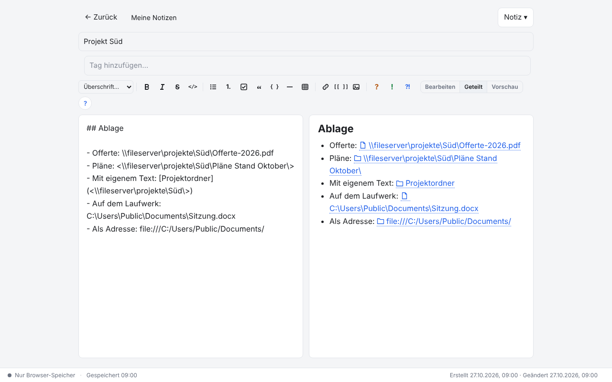
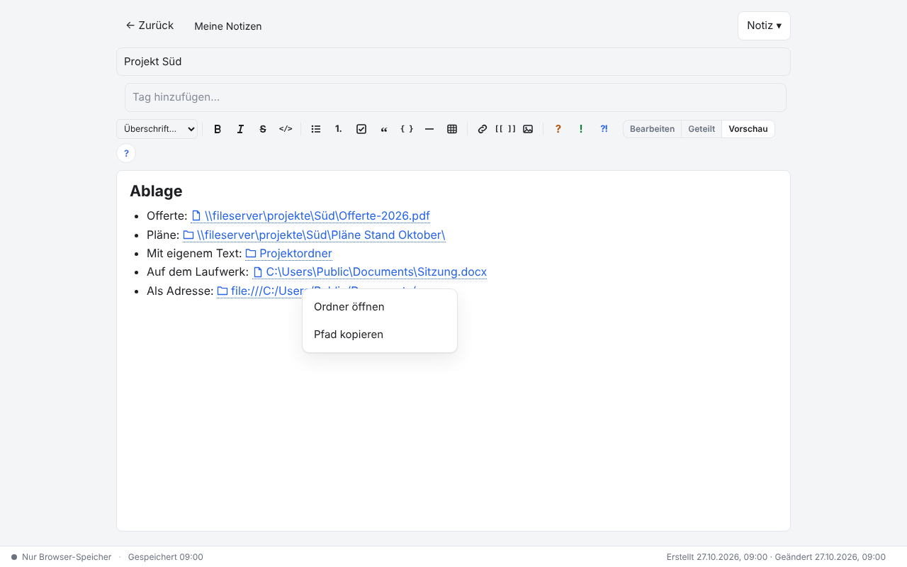
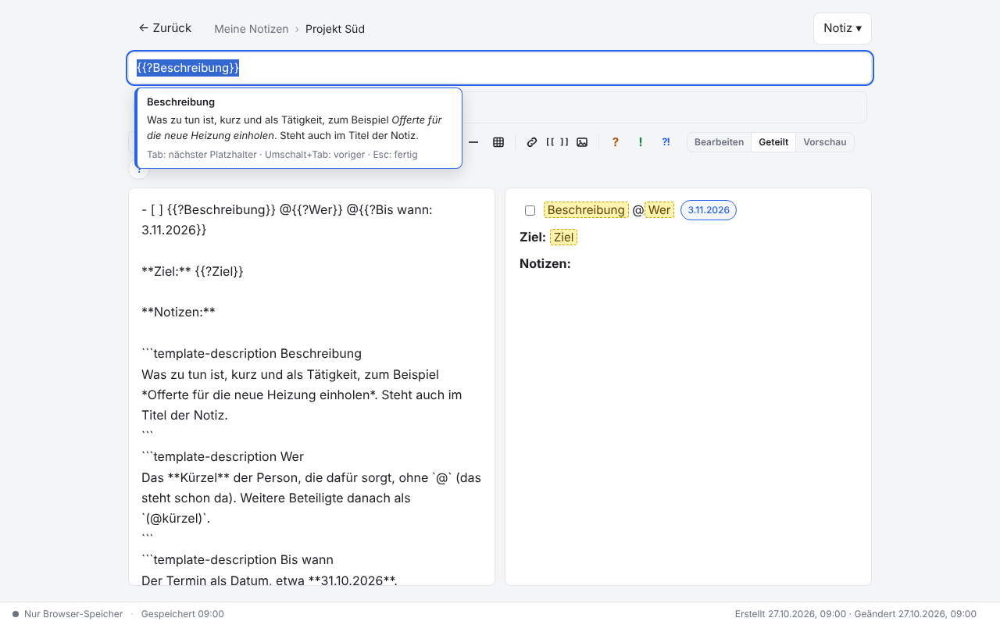
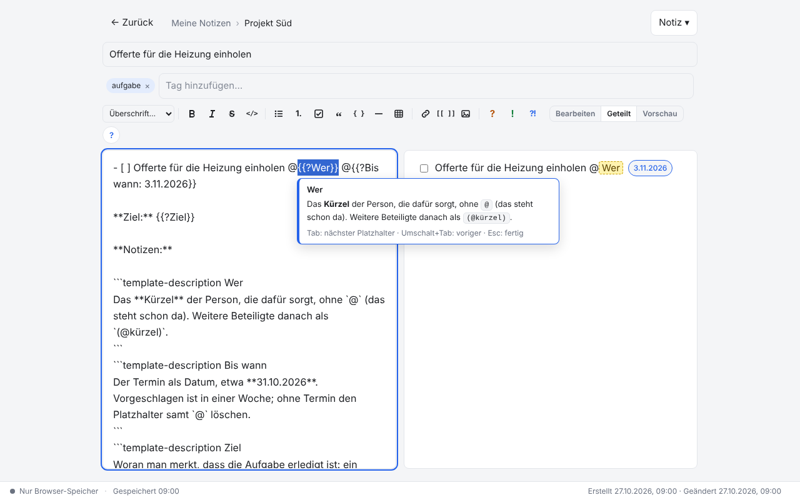
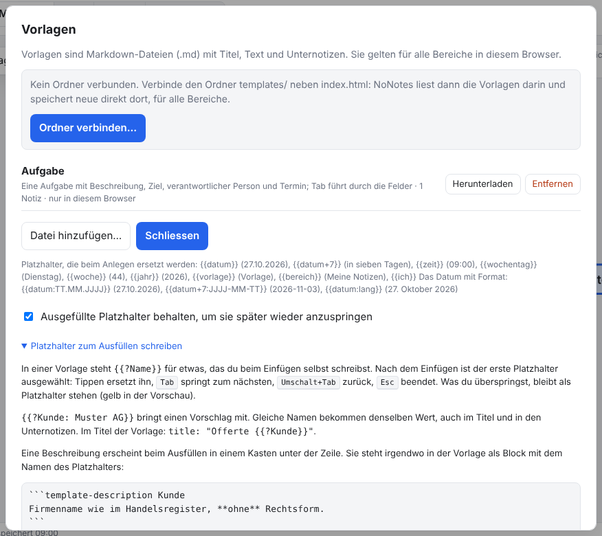
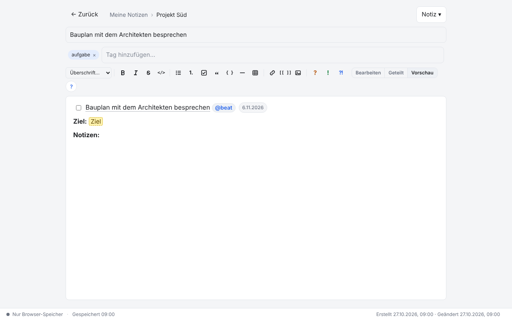
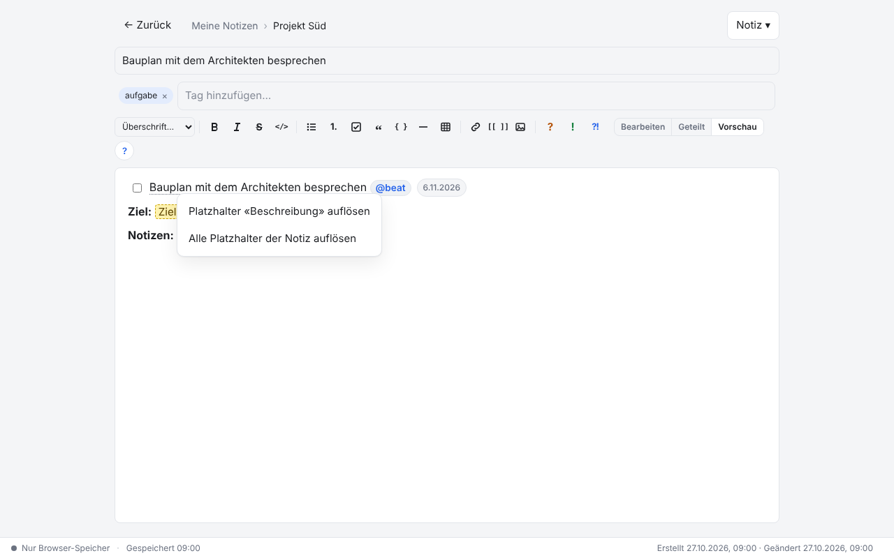
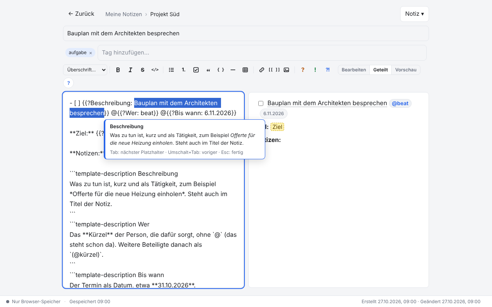

# NoNotes v2.12.0 – Pfade auf Dateien und Ordner, Vorlagen zum Ausfüllen

Notizen verweisen jetzt direkt auf Dateien und Ordner im Netzwerk oder auf dem eigenen Rechner, und Vorlagen bekommen Felder,
durch die man beim Anlegen mit `Tab` springt und die eine Beschreibung mitbringen. Die Datenbank bleibt unverändert.

## Was ist neu

### Pfade auf Dateien und Ordner

Netzwerkpfade (`\\server\freigabe\…`), Laufwerkspfade (`C:\…`) und `file://`-Adressen erkennt NoNotes im Text und zeigt sie als
Link mit einem Symbol für Datei oder Ordner; der ganze Pfad steht im Tooltip. Ein Pfad endet beim ersten Leerzeichen, Satzzeichen
am Ende gehören nicht dazu. Pfade mit Leerzeichen kommen in spitze Klammern, mit eigenem Text als Markdown-Link:

```markdown
- Offerte: \\fileserver\projekte\Süd\Offerte-2026.pdf
- Pläne: <\\fileserver\projekte\Süd\Pläne Stand Oktober\>
- Mit eigenem Text: [Projektordner](<\\fileserver\projekte\Süd\>)
- Auf dem Laufwerk: C:\Users\Public\Documents\Sitzung.docx
- Als Adresse: file:///C:/Users/Public/Documents/
```

Ein Pfad ohne Dateiendung oder mit `\` am Ende gilt als Ordner. Bilder mit einem Pfad (``)
erscheinen in der lokalen Version direkt in der Notiz. Fügst du einen Pfad ein, den der Explorer mit *Als Pfad kopieren* geliefert
hat, entfernt NoNotes die Anführungszeichen und setzt einen Pfad mit Leerzeichen gleich in `<…>`.



### Öffnen, Ordner öffnen, Pfad kopieren

In der lokalen Version öffnet ein Klick auf einen Pfad die Datei oder den Ordner in einem neuen Tab des Browsers. Der Rechtsklick
bietet *Öffnen* (bei Ordnern *Ordner öffnen*) und *Pfad kopieren*; kopiert wird der Pfad in Windows-Schreibweise, zum Einfügen in
den Explorer oder in eine Mail. Im Dienst kann der Browser keine Dateien auf deinem Rechner öffnen: Dort kopiert schon der Klick den
Pfad, und Bilder mit einem Pfad erscheinen als Link.



### Vorlagen mit Feldern zum Ausfüllen

Neben den automatischen Platzhaltern wie `{{datum+7}}` gibt es jetzt solche, die du beim Anlegen selbst ausfüllst: `{{?Name}}`.
Legst du eine Notiz aus einer solchen Vorlage an (*Aus Vorlage…* oder *Notiz → Vorlage einfügen…*), ist der erste ausgewählt, und
steht einer im Titel, zuerst der. Tippen ersetzt ihn, `Tab` springt zum nächsten, `Umschalt+Tab` zurück, `Esc` hört auf; nach dem
letzten springt `Tab` ans Ende des eingefügten Texts. Gleiche Namen meinen dasselbe: Der Wert steht danach überall, im Titel, im
Text und in den Unternotizen der Vorlage. Ein Platzhalter darf einen Vorschlag mitbringen, der ausgewählt ist und mit `Tab` stehen
bleibt, auch ein automatischer: `{{?Bis wann: {{datum+7}}}}`.

Zu jedem Namen kann die Vorlage eine Beschreibung mit Markdown enthalten, als Block irgendwo im Text:

````markdown
- [ ] {{?Beschreibung}} @{{?Wer}} @{{?Bis wann: {{datum+7}}}}

```template-description Wer
Das **Kürzel** der Person, die dafür sorgt, ohne `@` (das steht schon da).
```
````

Die Beschreibung erscheint in einem kleinen Kasten unter der Zeile, solange der Platzhalter ausgewählt ist; in der Notiz selbst ist
sie nicht zu sehen. Das Paket bringt die Beispielvorlage *Aufgabe* mit (Beschreibung, Wer, Bis wann, Ziel); `templates/README.md`
und die Hilfe (`F1`) erklären die Schreibweise.





### Platzhalter behalten

Übersprungene Platzhalter bleiben als `{{?Name}}` stehen und sind in der Vorschau gelb, damit nichts vergessen geht. Mit der
Einstellung *Ausgefüllte Platzhalter behalten* (*Datenbank → Vorlagen…*, je Bereich, im Dienst je Arbeitsbereich) bleiben auch
ausgefüllte stehen, als `{{?Wer: anna}}`. Eine Vorlage kann das mit `placeholders: "keep"` oder `"remove"` im Kopf selbst festlegen.
Im selben Dialog erklärt *Platzhalter zum Ausfüllen schreiben* die Schreibweise.



Die Vorschau zeigt von einem behaltenen Platzhalter nur den Wert, fein unterstrichen. Personen und Termine darin wirken wie sonst:
`- [ ] … @{{?Wer: beat}} @{{?Bis wann: 6.11.2026}}` ist eine Aufgabe für @beat bis 6.11.2026, in der Liste *Aufgaben*, im
Kalenderexport und im Dienst in den Erinnerungen per Mail. Suche, Listen, Druck und Export sehen nur den Wert, offene Platzhalter erscheinen dort als «[Name]».



Ein Klick auf einen behaltenen Wert wählt ihn im Text aus und zeigt die Beschreibung wieder; `Tab` springt von dort durch die
Platzhalter der Notiz. Rechtsklick → *Platzhalter auflösen* macht aus einem Platzhalter gewöhnlichen Text, *Alle Platzhalter der
Notiz auflösen* aus allen.





### Agenten füllen Vorlagen aus

`list_templates` nennt zu jeder Vorlage ihre Felder (`fields`: Name, Vorschlag, Beschreibung), und `create_note_from_template`
nimmt die Werte dafür (`values`, zum Beispiel `{ "Beschreibung": "Offerte einholen", "Wer": "anna" }`). Was ein Agent nicht
angibt, bleibt als Platzhalter offen und wartet auf dich. Pfade und Platzhalter in Notizen erklärt der Katalog den Agenten selbst.

<!-- ohne Bild: Schnittstelle für Agenten, ohne Oberfläche -->

## Update von v2.11.0

Die Notizen bleiben erhalten. Die Datenbank bleibt unverändert: v2.12.0 braucht kein neues Schema, die Einstellung *Platzhalter
behalten* liegt bei den übrigen Einstellungen des Bereichs.

1. **Sichern:** *Datenbank → Kopie herunterladen (.sqlite)*. Wer mit einer Datenbankdatei arbeitet, kopiert zusätzlich diese Datei.
2. **Herunterladen:** unten `NoNotes-v2.12.0.zip` oder `NoNotes-with-Plugins-v2.12.0.zip` und in einen neuen Ordner entpacken.
3. **Eigene Dateien übernehmen:** aus dem alten Ordner `plugins/plugins.js` (nur wenn dort Erweiterungen fest eingetragen sind),
   eigene Erweiterungen in `plugins/` und eigene Vorlagen in `templates/` in den neuen Ordner kopieren. Die neue Beispielvorlage
   `templates/Aufgabe.md` dabei nicht überschreiben.
4. **Öffnen:** `index.html` im neuen Ordner im selben Browser wie bisher. Oben neben dem Namen steht jetzt v2.12.0. Mit Datenbankdatei
   einmal *Mit Datei verbinden*.
5. **Vorlagen-Ordner neu verbinden** (nur wer ihn verbunden hatte): *Datenbank → Vorlagen… → Ordner verbinden* und den Ordner
   `templates/` im neuen Ordner wählen. Sonst liest NoNotes weiter den alten Ordner, und *Aufgabe* fehlt.
6. **Agenten-Programm** (nur wer `agent/nonotes-mcp.cjs` in Claude Code oder einem anderen Agenten eingetragen hat): den Pfad im
   Eintrag auf den neuen Ordner ändern; `node agent/nonotes-mcp.cjs --config "<Pfad zur NoNotes.sqlite>"` zeigt den Eintrag zum
   Kopieren.
7. **Prüfen:** Notizen, Erweiterungen (*Datenbank → Erweiterungen…*) und Hauptfarbe sind wie vorher. Fehlen die Notizen (anderer
   Browser oder anderes Profil): *Datenbank → Aus Datei importieren…* mit der Sicherung aus Schritt 1.
8. Den alten Ordner löschen, wenn alles da ist.

**Zurück zur vorigen Version:** geht ohne Weiteres, denn das Schema ist gleich: den alten Ordner behalten (oder v2.11.0 neu
herunterladen) und dort `index.html` öffnen. v2.11.0 kennt die neuen Platzhalter nicht und zeigt `{{?Name: Wert}}` als Text;
Personen und Termine in Platzhaltern erkennt sie nicht mehr, sobald du eine solche Notiz dort bearbeitest. Wer zurück will, löst
sie vorher mit *Alle Platzhalter der Notiz auflösen* auf.

**Erweiterungen:** Keine Änderung; alle Erweiterungen von v2.11.0 laufen weiter. *Tabellen formatieren* 1.0.1 (im Paket mit
Erweiterungen) hat jetzt eine Beschreibung im Dialog *Erweiterungen*.

**Eigene Backends und Agenten:** Keine neuen Methoden; die Einstellung *Platzhalter behalten* liegt mit `getMeta`/`setMeta` unter
`templates.keepPlaceholders` ([BACKEND.md](../../BACKEND.md)). Agenten: `list_templates` liefert neu `fields`,
`create_note_from_template` nimmt `values` (siehe oben).

## Für Entwickler

- `packages/core/placeholders.js` (`NoNotesPlaceholders`): Platzhalter finden (`scan`, `at`), ausfüllen (`fill`), auflösen
  (`resolve`), als Text für Index, Druck und Export (`flatten`, `plain`) und Beschreibungsblöcke (`descriptions`, `stripDescriptions`).
  Die Parser für Aufgaben, Fragen und Verweise lesen den Text mit den Werten; die Zeilennummern bleiben gleich.
- `NoNotesMarkdown.render(text, { placeholders: 'plain' })` zeigt nur die Werte (Druck); `configure({ localFiles })` legt fest, ob
  Pfade sich öffnen lassen (`shell.localFiles` in einer eigenen Hülle), `pathInfo(text)` erkennt einen Pfad.
- `NoNotesTemplates.create(backend, template, parentId, ctx, { values, keep })` legt eine Vorlage mit Werten an und liefert alle
  neuen Nummern; `parse` und `toMarkdown` kennen den Kopf `placeholders`.
