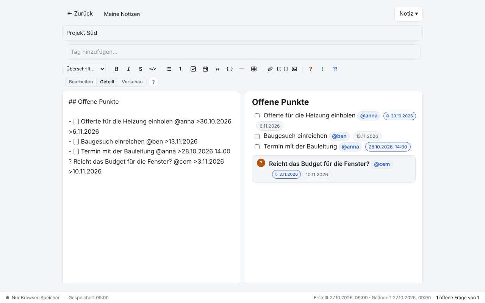
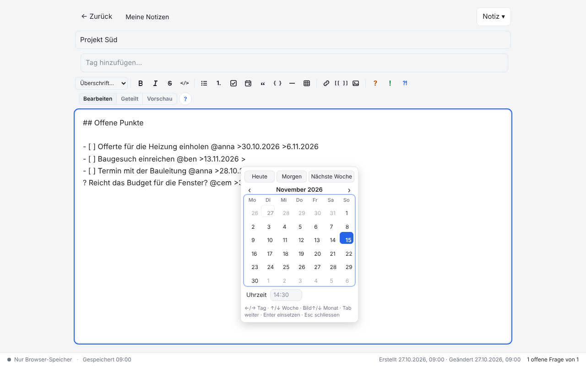
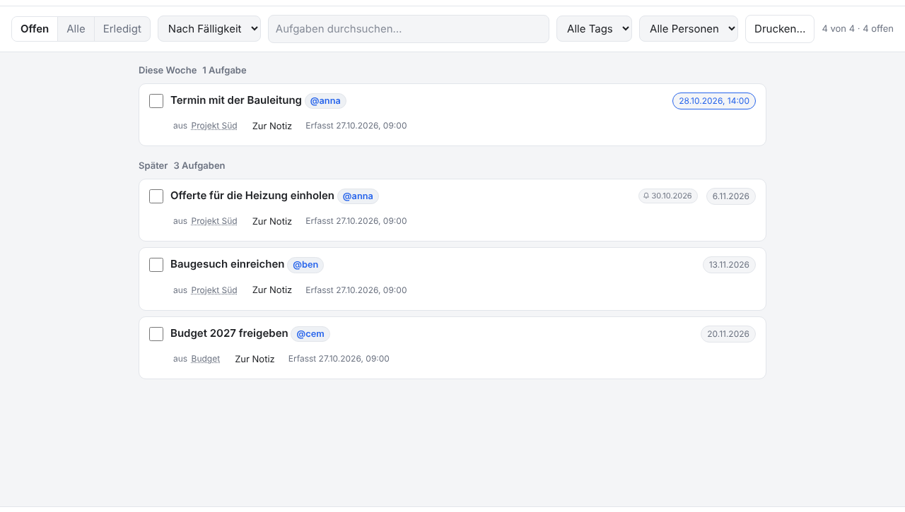
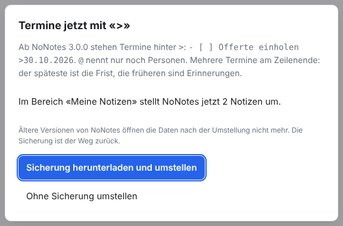
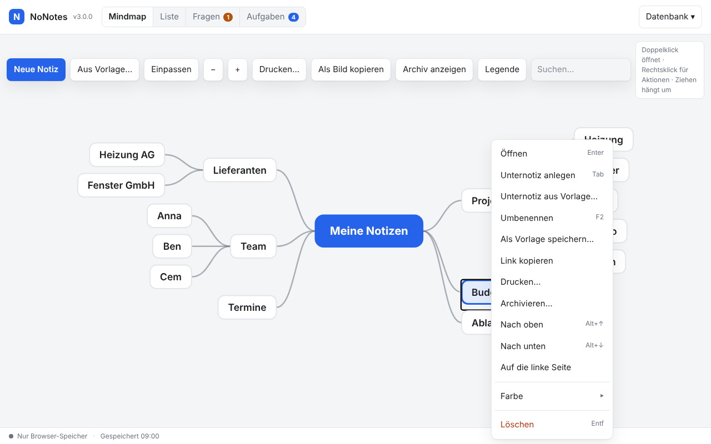
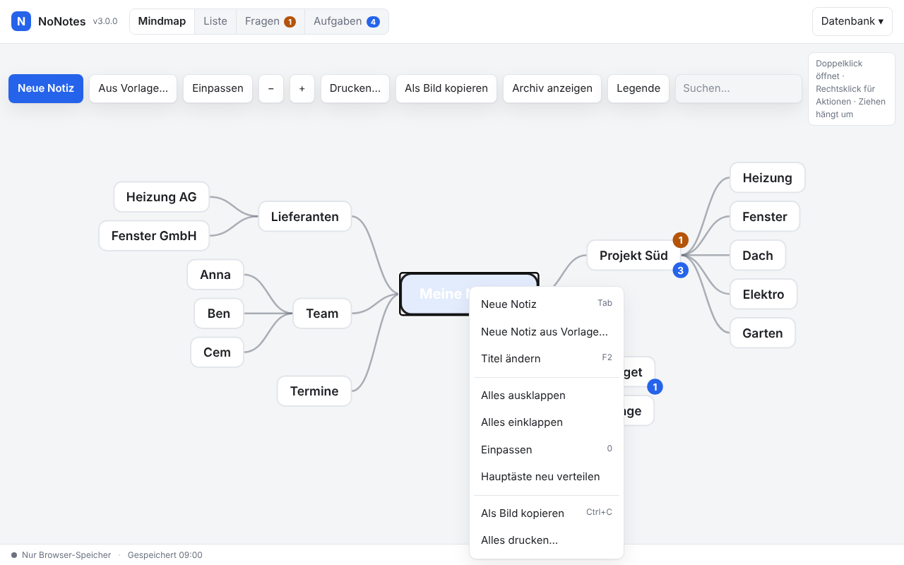
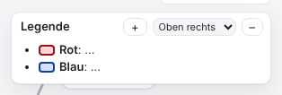
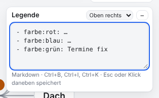

# NoNotes v3.0.0 – Termine mit «>», Frist und Erinnerungen, ruhigere Mindmap

Termine stehen jetzt hinter `>` statt hinter `@`, eine Datumsauswahl hilft beim Tippen, und mehrere Termine am Zeilenende sind
Frist und Erinnerungen. Die Hauptäste der Mindmap bleiben auf ihrer Seite, und die Mindmap lässt sich als Bild kopieren. Beim ersten
Öffnen stellt NoNotes die Daten um; danach öffnet sie keine ältere Version mehr. **Vor dem Update sichern.**

## Was ist neu

### Termine mit «>»

`@` nennt ab jetzt nur noch Personen, `>` steht für Termine. Der Termin steht wie bisher am Ende einer Aufgabe, einer Frage oder
eines Entscheids, mit einem Leerzeichen davor:

```markdown
- [ ] Baugesuch einreichen @ben >13.11.2026
- [ ] Termin mit der Bauleitung @anna >28.10.2026 14:00
? Reicht das Budget für die Fenster? @cem >10.11.2026
```

Kein Termin sind `>` am Zeilenanfang (ein Zitat), `->`, `=>`, `a > b` und alles in Code. Tippt man `@`, schlägt der Editor nur noch
Personen vor. Ein altes `@Datum` am Zeilenende (eingefügt aus einer Mail, von einem Agenten mit alter Anleitung) gilt weiter als
Termin und wird beim Speichern still zu `>Datum`; im Editor erst, wenn der Cursor die Zeile verlassen hat.



### Datumsauswahl

Tippt man `>` nach einem Leerzeichen, öffnet sich unter der Zeile ein kleiner Kalender. `←`/`→` wählen einen Tag, `↑`/`↓` eine
Woche, `Bild↑`/`Bild↓` einen Monat; `Tab` geht durch *Heute*, *Morgen*, *Nächste Woche*, den Kalender und das Feld *Uhrzeit*.
`Enter` oder ein Klick setzt das Datum ein, immer ganz (`13.11.2026`), damit in einem Jahr noch klar ist, welcher Tag gemeint war.
`Esc` schliesst und lässt das `>` stehen. Wer lieber Ziffern tippt, tippt weiter, der Kalender folgt. Der Knopf *Termin* in der
Toolleiste setzt ` >` ans Zeilenende; `Ctrl+Leertaste` auf einem Termin oder ein Klick auf sein Abzeichen in der Vorschau ändert ihn.



### Frist und Erinnerungen

Stehen mehrere Termine am Zeilenende, ist der späteste die **Frist** und die früheren sind **Erinnerungen**:
`- [ ] Offerte einholen @anna >30.10.2026 >6.11.2026` ist fällig am 6.11. und erinnert am 30.10. «Überfällig» richtet sich nur nach
der Frist. Fügt die Datumsauswahl einen Termin in eine Zeile ein, ordnet sie die Termine nach dem Datum. Die Vorschau zeigt
Erinnerungen als kleines Abzeichen mit Glocke, die Listen *Aufgaben*, *Fragen* und *Entscheide* die Frist und die nächste Erinnerung.



Der Kalenderexport (`.ics`) macht aus jeder Erinnerung einen Alarm zum festen Zeitpunkt (ohne Uhrzeit um 9 Uhr). Im Dienst kommt an
jedem Erinnerungstag die Morgenmail mit der Gruppe «Erinnerung heute».

### Umstellung beim ersten Öffnen

Öffnet NoNotes 3.0.0 einen Bereich zum ersten Mal, schreibt es in allen Notizen jedes `@Datum` am Zeilenende zu `>Datum` um, auch
in Tabellenfeldern und Vorlagen, nicht in Code. Vorher fragt es einmal und lädt auf Wunsch eine Sicherung des alten Stands herunter
(`NoNotes-vor-3.0.0-<Bereich>.sqlite`). Die Texte behalten ihre Länge, «Geändert» bleibt, und der Verlauf bekommt einen Vermerk
«Umstellung auf v3.0.0» statt einer neuen Fassung je Notiz.



Vorlagen im verbundenen Ordner `templates/` liest NoNotes auch mit `@Datum` richtig. *Datenbank → Vorlagen…* nennt sie und bietet
**Auf «>» umstellen** an, das die Dateien im Ordner umschreibt. Die Beispiele im ZIP kommen schon mit `>`.

### Mindmap: Hauptäste bleiben auf ihrer Seite

Bisher verteilte die Mindmap die Hauptäste bei jedem Zeichnen neu, und ein neuer Ast liess andere von einer Seite auf die andere
springen. Jetzt behält jeder Hauptast seine Seite; ein neuer kommt auf die kürzere. Wechseln geht per Rechtsklick → *Auf die linke
Seite* (*rechte*) oder indem man den Ast auf die andere Hälfte der Wurzel zieht. Beim ersten Öffnen verteilt NoNotes eine
bestehende Mindmap einmal ausgewogen, die grössten Äste zuerst. Ändert sich das Bild, gleiten die Knoten kurz an ihren neuen Platz
(nicht mit «Bewegung reduzieren» des Systems und nicht bei sehr grossen Mindmaps).



### Mindmap als Bild kopieren und neu verteilen

**Als Bild kopieren** in der Leiste der Mindmap, `Ctrl+C` in der Mindmap oder Rechtsklick auf die Wurzel legt die Mindmap so, wie
sie zu sehen ist, als PNG in die Zwischenablage: eingeklappte Äste bleiben zu, Archiv und Querverweise wie eingeblendet. So landet
sie direkt in einer Mail, in Word oder PowerPoint. Ein Browser, der keine Bilder in die Zwischenablage legt, lädt das Bild herunter.
**Hauptäste neu verteilen** im selben Menü verteilt alle Äste wieder ausgewogen auf beide Seiten.



### Legende: fehlende Farben ergänzen

Die Erweiterung *Farben über Tags* (2.3.0, im Paket mit Erweiterungen) zeigt im Kopf der Legende einen Knopf **+**, sobald eine
benutzte Farbe in der Legende fehlt. Er hängt für jede fehlende Farbe eine Zeile wie `- farbe:grün: …` an und öffnet die Legende zum
Bearbeiten, die neue Bedeutung ausgewählt. Was schon dasteht, bleibt unberührt.





### Agenten

Die Anleitung für Agenten erklärt `>`, die Frist und die Erinnerungen. `list_tasks` und `list_questions` liefern dazu `reminders`
(die früheren Termine) neben `due` (der Frist). Das Programm `agent/nonotes-mcp.cjs` liest Dateien von 2.x und legt vor dem ersten
Schreiben einer solchen Datei den alten Stand als `<Name>-vor-3.0.0.sqlite` daneben.

<!-- ohne Bild: Schnittstelle für Agenten, ohne Oberfläche -->

## Update von v2.12.0

Die Notizen bleiben erhalten. Die Datenbank geht von Schema 16 auf **Schema 17**: NoNotes schreibt dabei die Termine um und füllt
die Indexe neu. **Danach öffnet keine ältere Version die Daten mehr; zurück geht es nur mit der Sicherung.**

1. **Sichern:** in v2.12.0 *Datenbank → Kopie herunterladen (.sqlite)*, für jeden Bereich. Wer mit einer Datenbankdatei arbeitet,
   kopiert zusätzlich diese Datei.
2. **Herunterladen:** unten `NoNotes-v3.0.0.zip` oder `NoNotes-with-Plugins-v3.0.0.zip` und in einen neuen Ordner entpacken.
3. **Eigene Dateien übernehmen:** aus dem alten Ordner `plugins/plugins.js` (nur wenn dort Erweiterungen fest eingetragen sind),
   eigene Erweiterungen in `plugins/` und eigene Vorlagen in `templates/` in den neuen Ordner kopieren. Die Beispielvorlagen
   (`Aufgabe.md`, `Entscheidungsvorlage.md`, `Sitzungsprotokoll.md`) nicht mit den alten überschreiben: die neuen schreiben `>`.
4. **Öffnen:** `index.html` im neuen Ordner im selben Browser wie bisher. Für jeden Bereich mit Terminen fragt NoNotes einmal:
   **Sicherung herunterladen und umstellen** (empfohlen) oder ohne Sicherung. Mit Datenbankdatei einmal *Mit Datei verbinden*;
   auch dann fragt NoNotes vor dem Umschreiben der Datei.
5. **Vorlagen-Ordner** (nur wer ihn verbunden hatte): *Datenbank → Vorlagen… → Ordner verbinden* und den Ordner `templates/` im
   neuen Ordner wählen. Nennt der Dialog Vorlagen mit `@Datum`, mit **Auf «>» umstellen** umschreiben.
6. **Agenten-Programm** (nur wer `agent/nonotes-mcp.cjs` eingetragen hat): den Pfad im Eintrag auf den neuen Ordner ändern;
   `node agent/nonotes-mcp.cjs --config "<Pfad zur NoNotes.sqlite>"` zeigt den Eintrag zum Kopieren.
7. **Prüfen:** Aufgaben und Fragen haben ihre Termine (*Aufgaben*, *Fragen*), die Mindmap ist vollständig, Erweiterungen und
   Hauptfarbe sind wie vorher. Fehlen die Notizen (anderer Browser oder anderes Profil): *Datenbank → Aus Datei importieren…* mit der
   Sicherung aus Schritt 1; sie wird dabei ebenfalls umgestellt.
8. Den alten Ordner löschen, wenn alles da ist. Die Sicherungen aufbewahren.

**Zurück zur vorigen Version:** nur mit der Sicherung aus Schritt 1 oder 4 (`NoNotes-vor-3.0.0-<Bereich>.sqlite`): v2.12.0 öffnen
und *Datenbank → Aus Datei importieren…*. Was nach der Umstellung geschrieben wurde, fehlt dann. Eine umgestellte Datei meldet in
v2.12.0 «App aktualisieren».

**Mehrere Personen, eine Datei:** Alle stellen gleichzeitig auf 3.0.0 um. Öffnet v3.0.0 eine Datei, die eine 2.x-Version
geschrieben hat, fragt es wieder nach der Sicherung, bevor es sie umstellt.

**Erweiterungen:** Alle Erweiterungen von v2.12.0 laufen weiter (`api: 1` unverändert). Wer Termine in Notizen schreibt, schreibt sie
mit `>` ([PLUGINS.md](../../PLUGINS.md), «Termine im Text»); ein `@Datum` stellt NoNotes beim Speichern selbst um. *Farben über
Tags* 2.3.0 (im Paket mit Erweiterungen) bringt den Knopf **+** in der Legende.

**Eigene Backends und Agenten:** Neu sind `setSides({ id: 'left' | 'right' | null })` und `side` in den Zeilen von `getTree`; die
Zeilen von `listTasks`, `getTask`, `listQuestions` und `getQuestion` tragen `reminders` ([BACKEND.md](../../BACKEND.md)). Agenten
lesen die neue Anleitung beim nächsten Start.

## Für Entwickler

- `packages/core/dates.js`: `tail(text)` liest die Termine am Zeilenende (`>` und das alte `@`), `splitDue(text)` liefert
  `{ text, due, reminders, legacy }`, `rewriteLegacy(text)` schreibt `@Datum` zu `>Datum` um (gleiche Länge, nicht in Code),
  `toText(iso)` das ganze Datum für den Text.
- `packages/data/db.js`: Schema 17 mit `tasks.reminders`, `questions.reminders` (JSON) und `notes.side`; `DB.open(SQL, bytes, info)`
  meldet `upgradedFrom` und `rewritten`, `DB.inspect(SQL, bytes)` zählt vorher die Notizen mit `@Datum`.
- `packages/ui/datepicker.js` (`NoNotesDatePicker.create`): die Datumsauswahl, ohne Abhängigkeit vom Editor.
- `packages/ui/mindmap.js`: das Layout hält die Seiten fest und meldet neue (`onSides`), `balancedSides()` und `sides()` für
  «Neu verteilen» und den Export, Gleiten beim Neuzeichnen.
- Die lokale Hülle fragt über `host.confirmMigration({ area, notes })` vor der Umstellung.
