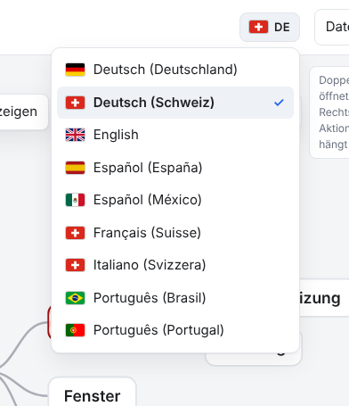
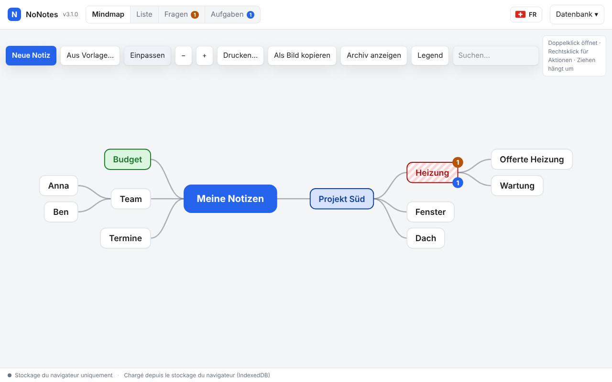
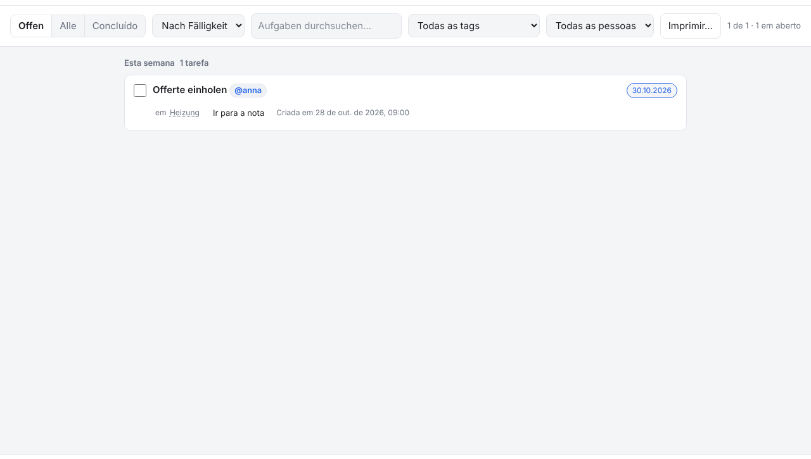
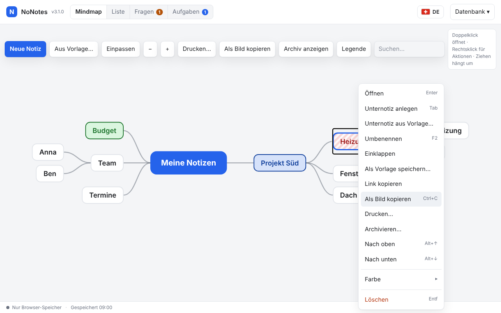
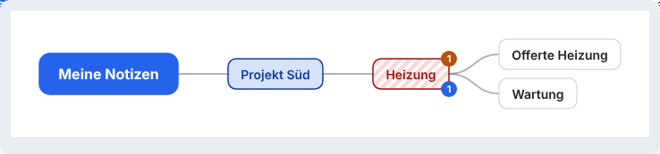
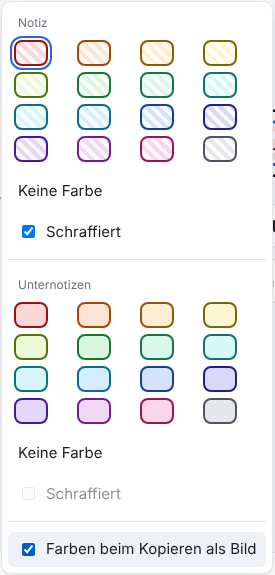

# NoNotes v3.1.0 – Neun Sprachen mit Flagge, Mindmap ab einem Knoten als Bild

NoNotes spricht jetzt neun Sprachen: zu Deutsch (Schweiz) und Englisch kommen Deutsch (Deutschland), Französisch und Italienisch
der Schweiz, Spanisch aus Spanien und Mexiko sowie Portugiesisch aus Portugal und Brasilien. Gewechselt wird mit dem neuen
Knopf mit Flagge oben rechts. Dazu lässt sich die Mindmap ab einem Knoten als Bild kopieren, mit dem Weg von der Wurzel; die
Daten bleiben, wie sie sind.

## Was ist neu

### Sprachwechsel mit Flagge

Oben rechts, neben **Datenbank**, steht ein Knopf mit der Flagge und dem Kürzel der Sprache (`DE`, `FR`, `PT` …). Ein Klick öffnet
die Liste aller Sprachen mit Flagge und Namen, nach Namen sortiert; die gewählte trägt ein Häkchen. Mit der Tastatur: `↓` auf dem
Knopf öffnet die Liste, Pfeile und `Pos1`/`Ende` wandern, ein Anfangsbuchstabe springt (`p` → Português), `Enter` wählt, `Esc`
schliesst. Die Wahl wird im Browser gemerkt; NoNotes sichert die offene Notiz und lädt neu, die Notizen bleiben. Die bisherige
Auswahl im Menü **Datenbank** ist dafür weggefallen.

### Sieben neue Sprachen

Neu sind **Deutsch (Deutschland)** (mit ß, „Anführungszeichen“ und «Entscheidung» statt «Entscheid»), **Français (Suisse)**,
**Italiano (Svizzera)**, **Español (España)**, **Español (México)**, **Português (Portugal)** und **Português (Brasil)**: die ganze
Oberfläche mit Hilfe, Rückfragen, Druck, Export und Kalender. Zeitangaben (*Erstellt*, *Geändert*) und Monatsnamen folgen der
Sprache; Termine schreibt und zeigt NoNotes in jeder Sprache gleich (`>30.10.2026`). Beim ersten Start wählt
NoNotes die Sprache des Browsers, auch über die Region: ein Browser auf `de-AT` bekommt Deutsch (Deutschland), `es-AR`
Español (México), `fr-FR` Français (Suisse). Die Schreibweise im Text (`- [ ]`, `?`, `!`, `?!`, `>Datum`, `@kürzel`) ist in allen
Sprachen dieselbe. Platzhalter in Vorlagen gibt es in jeder Sprache (`{{datum}}`, `{{date}}`, `{{fecha}}`, `{{data}}` …), und jede
Vorlage versteht die Namen aller Sprachen.

### Mindmap ab einem Knoten als Bild kopieren

*Als Bild kopieren* gibt es jetzt auch für einen Knoten: Rechtsklick auf den Knoten → **Als Bild kopieren**. Das Bild zeigt den
Weg von der Wurzel bis zum Knoten und den Knoten mit seinen Unternotizen; alle anderen Äste sind ausgeblendet. Eingeklappte Äste
unter dem Knoten bleiben zu, wie auf dem Schirm. `Ctrl`+`C` und der Knopf **Als Bild kopieren** in der Leiste folgen der Auswahl:
ein Knoten gewählt → ab dem Knoten, mehrere gewählt (`Ctrl`+Klick) → ein Bild mit allen Wegen, sonst die ganze Mindmap. Heisst der
Bereich anders als die Mindmap, steht sein Name als Überschrift über dem Bild.

### Farben über Tags im kopierten Bild

Die Erweiterung *Farben über Tags* (2.4.0, im Paket mit Erweiterungen) bringt ihre Farben jetzt auch ins kopierte Bild,
schraffierte Knoten mit Streifen. Wer das nicht will, nimmt das Häkchen weg: Rechtsklick auf einen Knoten → **Farbe ▸** →
**Farben beim Kopieren als Bild**. Das gilt in diesem Browser, wirkt sofort und geht auch im Lesemodus, wo das Untermenü nur das
Häkchen zeigt. Export und Druck zeichnen die Mindmap weiterhin ohne diese Farben.

## Behoben

- Hilfe, Reiter *Tastenkürzel*: die Taste `Entf` blieb in anderen Sprachen deutsch; sie heisst jetzt wie auf der Tastatur der
  Sprache (`Del`, `Suppr`, `Canc`, `Supr`).

## Update von v3.0.0

Die Notizen bleiben erhalten, die Datenbank bleibt unverändert (Schema 17). Der Weg zurück zu v3.0.0 geht ohne Weiteres.

1. **Sichern:** *Datenbank → Kopie herunterladen (.sqlite)*, für jeden Bereich. Wer mit einer Datenbankdatei arbeitet, kopiert
   zusätzlich diese Datei.
2. **Herunterladen:** unten `NoNotes-v3.1.0.zip` oder `NoNotes-with-Plugins-v3.1.0.zip` und in einen neuen Ordner entpacken.
3. **Eigene Dateien übernehmen:** aus dem alten Ordner `plugins/plugins.js` (nur wenn dort Erweiterungen fest eingetragen sind),
   eigene Erweiterungen in `plugins/` und eigene Vorlagen in `templates/` in den neuen Ordner kopieren.
4. **Öffnen:** `index.html` im neuen Ordner im selben Browser wie bisher. Oben neben dem Namen steht jetzt v3.1.0. Mit
   Datenbankdatei einmal *Mit Datei verbinden*.
5. **Sprache prüfen:** Wer die Sprache nie gewählt hat, bekommt jetzt die Sprache des Browsers, wenn es sie neu gibt (etwa
   Französisch statt Deutsch). Zurück geht es mit dem Knopf mit der Flagge oben rechts. Eine einmal gewählte Sprache bleibt.
6. Den alten Ordner löschen, wenn alles da ist.

**Erweiterungen:** Alle Erweiterungen laufen weiter (`api: 1` unverändert). `ctx.language()` liefert jetzt auch Kennungen mit
Region (`de-DE`, `fr-CH`, `pt-BR` …); wer nach der Sprache auswählt, nimmt den Teil vor dem Bindestrich
([PLUGINS.md](../../PLUGINS.md)). Die Texte der Erweiterungen bringen diese selbst mit; die mitgelieferten zeigen in den neuen
Sprachen Englisch, in Deutsch (Deutschland) Deutsch.

**Eigene Backends und Agenten:** nichts zu tun.

## Für Entwickler

- Sprachpakete melden mit `register(code, name, messages, { locale, flag, regions })` die Flagge (Land nach ISO 3166) und die
  Regionen der Browsersprache, die sie bekommen; `NoNotesI18n.match(tag)` ordnet eine Browsersprache einem Paket zu,
  `available()` liefert dazu `flag` und `locale`. Flaggen zeichnet `packages/ui/flags.js` (`NoNotesFlags.html(land)`).
- `tools/i18n.cjs check` prüft jetzt auch die Namen der Platzhalter und Datumsstile (ein Wort, über alle Sprachen eindeutig) und
  die Datumsformate; `update` behält `flag` und `regions`. Wie man eine Sprache ergänzt: [LANGUAGES.md](../../LANGUAGES.md).
- `translateDom` übersetzt erzwungene Teile (`data-i18n`) auch in Elementen ohne eigenen Text (`<dt><kbd data-i18n>Entf</kbd></dt>`).
- Mindmap-Bild: `NoNotesMindmap.toSvgString(rows, { focus, caption, style })`; Erweiterungen färben Knoten über
  `ctx.export.addMapStyle(fn)` mit `fn({ target: 'export' | 'print' | 'copy', ids })` → `{ nodes, defs }` ([PLUGINS.md](../../PLUGINS.md)).
