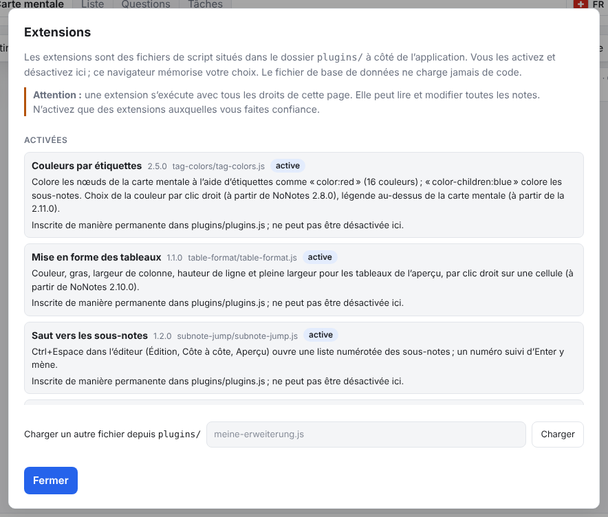
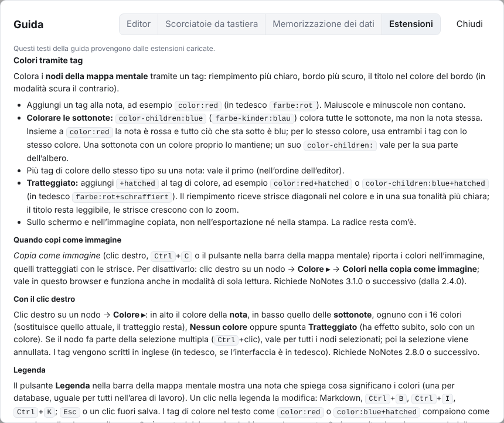
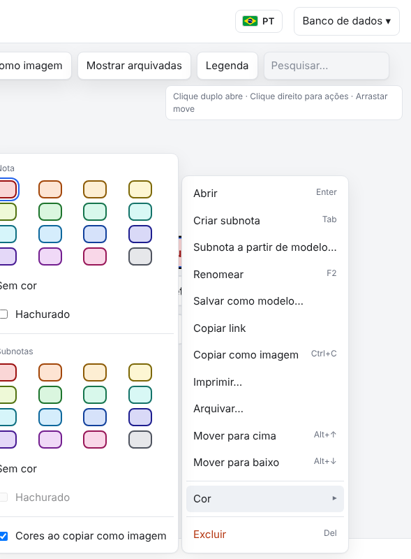

# NoNotes v3.1.1 – Erweiterungen in neun Sprachen

Die mitgelieferten Erweiterungen sprechen jetzt alle neun Sprachen von NoNotes: Name und Beschreibung im Dialog *Erweiterungen…*,
die Hilfe und alle Beschriftungen. Die Notizen und die Datenbank bleiben, wie sie sind.

## Was ist neu

### Erweiterungen in der Sprache der Oberfläche

Bisher zeigten die Erweiterungen in den sieben neuen Sprachen von v3.1.0 Englisch, in Deutsch (Deutschland) Schweizer Deutsch.
Jetzt folgen sie der Sprache, die oben rechts mit der Flagge gewählt ist: *Farben über Tags*, *Tabellen formatieren*, *Sprung zu
Unternotizen*, *Tag-Designs*, *Szenen-Hintergründe* (im Paket mit Erweiterungen) und die beiden Beispiele *Datum einfügen* und
*Sepia*. Im Dialog **Datenbank → Erweiterungen…** stehen Name und Beschreibung in dieser Sprache, ebenso die Knöpfe, Menüs und
Fenster der Erweiterungen. Ein Wechsel der Sprache lädt die Seite neu, die Erweiterungen kommen gleich in der neuen Sprache.

### Hilfe der Erweiterungen je Sprache

Im Hilfefenster, Reiter **Erweiterungen**, erklärt jede eingeschaltete Erweiterung sich selbst in der gewählten Sprache: wie man
sie benutzt, welche Tasten gelten und was sich anpassen lässt. Die Namen von Knöpfen und Menüs darin heissen so wie in der
Oberfläche derselben Sprache.

### Farben über Tags: Tags in der Sprache der Oberfläche

*Farben über Tags* (2.5.0) schreibt die Tags im Untermenü **Farbe ▸** in deutscher Oberfläche wie bisher deutsch (`farbe:rot`,
`farbe-kinder:blau`, `+schraffiert`), in allen anderen Sprachen englisch (`color:red`, `color-children:blue`, `+hatched`). Gelesen
werden beide Schreibweisen in jeder Sprache: Notizen mit deutschen Tags behalten ihre Farbe auch auf Französisch.

## Behoben

- *Sprung zu Unternotizen*: zeigte in Deutsch (Deutschland) englische Beschriftungen, weil es nur `de` als Deutsch erkannte.
- *Datum einfügen* (Beispiel): schreibt das Datum im Format der gewählten Sprache statt immer Schweizer Deutsch.

## Update von v3.1.0

Die Notizen bleiben erhalten, die Datenbank bleibt unverändert (Schema 17). Der Weg zurück zu v3.1.0 geht ohne Weiteres.

1. **Sichern:** *Datenbank → Kopie herunterladen (.sqlite)*, für jeden Bereich. Wer mit einer Datenbankdatei arbeitet, kopiert
   zusätzlich diese Datei.
2. **Herunterladen:** unten `NoNotes-v3.1.1.zip` oder `NoNotes-with-Plugins-v3.1.1.zip` und in einen neuen Ordner entpacken.
3. **Eigene Dateien übernehmen:** aus dem alten Ordner `plugins/plugins.js` (nur wenn dort Erweiterungen fest eingetragen sind),
   eigene Erweiterungen in `plugins/` und eigene Vorlagen in `templates/` in den neuen Ordner kopieren.
4. **Öffnen:** `index.html` im neuen Ordner im selben Browser wie bisher. Oben neben dem Namen steht jetzt v3.1.1. Mit
   Datenbankdatei einmal *Mit Datei verbinden*.
5. **Prüfen:** Notizen, Erweiterungen (*Datenbank → Erweiterungen…*) und Hauptfarbe sind wie vorher.
6. Den alten Ordner löschen, wenn alles da ist.

**Erweiterungen:** Alle Erweiterungen laufen weiter (`api: 1` unverändert). Die neuen Fassungen (*Farben über Tags* 2.5.0,
*Tabellen formatieren* 1.1.0, *Sprung zu Unternotizen* 1.2.0, *Tag-Designs* 1.2.0, *Szenen-Hintergründe* 1.2.0) laufen auch mit
v3.1.0; dort zeigt nur der Dialog *Erweiterungen…* Name und Beschreibung deutsch.

**Eigene Backends und Agenten:** Keine Änderung.

## Für Entwickler

- `NoNotesPlugins.register()` nimmt `names` und `descriptions` an: wie `help` je Sprache (`{ de: '…', en: '…', 'pt-br': '…' }`),
  gewählt nach der Kennung der Oberfläche, dann der Sprache vor dem Bindestrich, dann `''`, Englisch, Deutsch. `name` und
  `description` bleiben der Rückfall für ältere Versionen. Das Verzeichnis aus dem Build (`NoNotesPlugins.catalog([…])` in `plugins/plugins.js`) trägt beide mit,
  damit der Dialog auch ausgeschaltete Erweiterungen in der richtigen Sprache zeigt ([PLUGINS.md](../../PLUGINS.md), Abschnitt
  «Texte der Erweiterung»).
- Die Beispiele `plugins/beispiele/datum-einfuegen.js` und `sepia.js` zeigen, wie eine Erweiterung ihre Texte in einer Tabelle je
  Sprache führt und die passende wählt.
