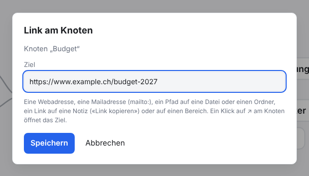
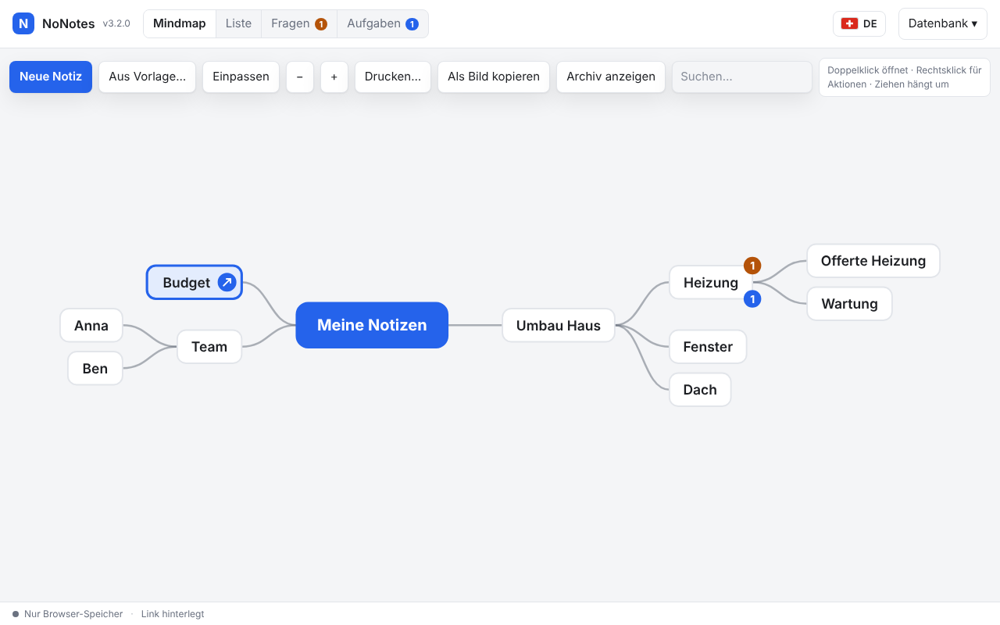
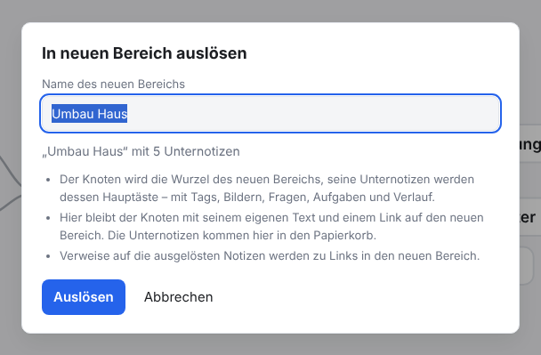
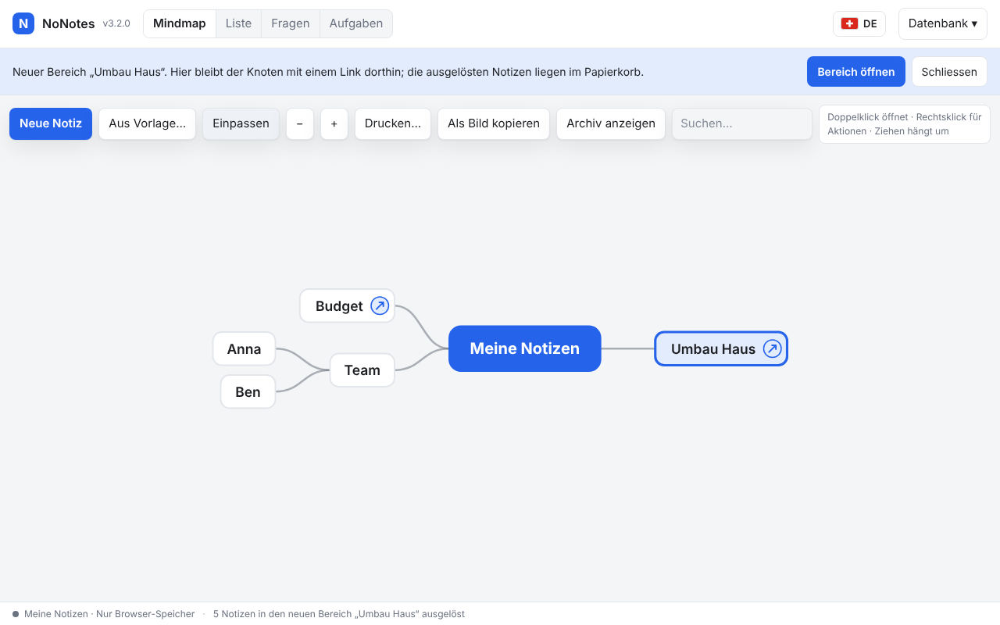
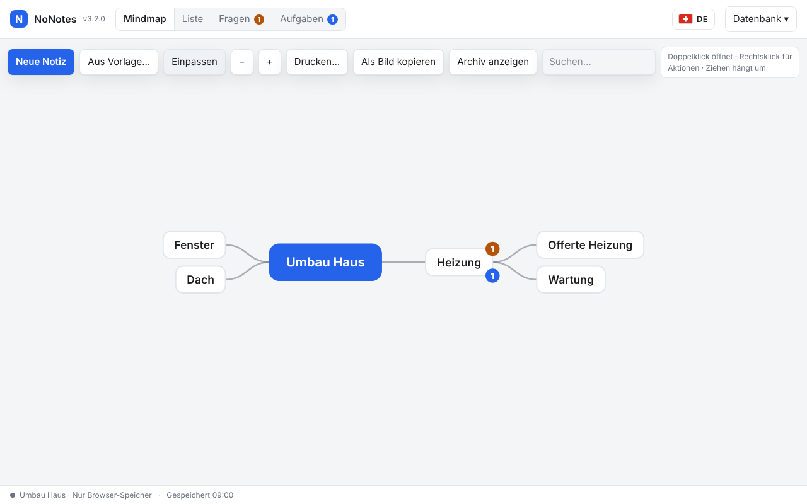
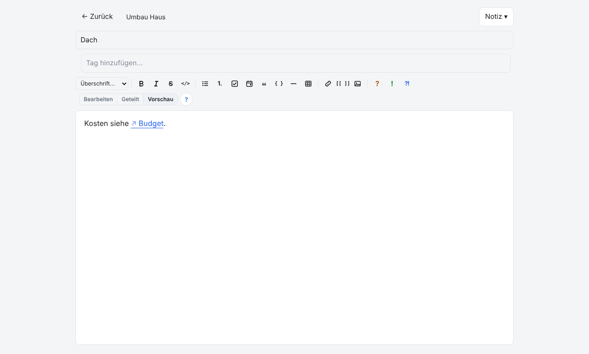

# NoNotes v3.2.0 – Link am Knoten und Knoten in einen neuen Bereich auslösen

Ein Knoten der Mindmap kann jetzt direkt auf etwas zeigen: eine Webseite, eine Datei, eine andere Notiz oder einen anderen Bereich.
Wird ein Ast zu gross, löst ihn ein Rechtsklick samt Unternotizen in einen eigenen Bereich aus; im alten Bereich bleibt der Knoten mit
einem Link dorthin.

## Was ist neu

### Link am Knoten

Rechtsklick auf einen Knoten → **Link hinterlegen…** (oder im Editor *Notiz → Link am Knoten…*). Als Ziel gehen eine Webadresse
(`www.…` genügt), eine Mailadresse (`mailto:…`), ein Pfad auf eine Datei oder einen Ordner (`\\server\Projekte\Budget.xlsx`,
`Z:\Team\`), ein Link auf eine Notiz (*Link kopieren*) oder ein anderer Bereich, den der Dialog zur Auswahl anbietet.



Der Knoten zeigt dann ↗. Ein Klick auf das Zeichen öffnet das Ziel: eine Webseite in einem neuen Tab, eine Notiz oder einen Bereich
in der App; einen Pfad öffnet die lokale Version wie einen Pfad im Text, im Dienst wird er kopiert. Ein Doppelklick auf den Knoten
öffnet wie immer den Editor, dort steht der Link unter dem Titel. Ändern und entfernen geht über denselben Rechtsklick. Der Link
gehört zum Knoten, nicht zum Text: Er erscheint beim Drucken und im Markdown-Export als eigene Zeile und im Bild der Mindmap als ↗.



### Knoten in einen neuen Bereich auslösen

Rechtsklick auf einen Knoten → **In neuen Bereich auslösen…**. Der Dialog schlägt den Titel des Knotens als Namen vor und nennt die
Zahl der Unternotizen, die mitgehen.



- **Im neuen Bereich** wird der Knoten die Wurzel (der Name des Bereichs), seine Unternotizen werden die Hauptäste. Mit ihnen ziehen
  Tags, Bilder, Fragen, Entscheide, Aufgaben, archivierte Unternotizen und der **Verlauf** jeder Notiz um.
- **Im alten Bereich** bleibt der Knoten mit seinem eigenen Text und einem Link auf den neuen Bereich. Die Unternotizen liegen dort im
  Papierkorb, an ihrem alten Platz im Baum; wer es sich anders überlegt, holt sie zurück.
- Ein Hinweis oben bietet **Bereich öffnen** an; ebenso führt ein Klick auf ↗ hinüber. Zurück im Browser führt in den alten Bereich.





**Verweise stimmen weiter.** `[[…]]` und Links zwischen Notizen, die zusammen umziehen, bleiben, wie sie sind (eine Nummer wie
`[[Heizung#12]]` bekommt die neue). Zeigt ein Verweis über die Grenze (eine umgezogene Notiz auf eine gebliebene oder umgekehrt),
wird er zum Link in den anderen Bereich, mit dem Titel als Text. Bilder bekommen neue Nummern im neuen Bereich. Text in Code
(`` `…` `` und ```` ``` ````-Blöcke) bleibt unberührt.



In der lokalen Version entsteht ein neuer Bereich im selben Browser, ohne Datenbankdatei. Wer mit Datenbankdateien arbeitet, verbindet
den neuen Bereich danach mit einer eigenen Datei (*Datenbank → Datenbankdatei anlegen…*). Im Dienst steht der Eintrag nur der Besitzerin oder dem Besitzer des
Arbeitsbereichs zur Verfügung; der neue Arbeitsbereich bekommt dieselben Mitglieder mit denselben Rollen.

## Update von v3.1.1

Die Notizen bleiben erhalten. Die App gleicht die Datenbank beim ersten Öffnen selbst an (Schema 17 → 18, eine neue Spalte für den
Link am Knoten); das geht schnell.

1. **Sichern:** *Datenbank → Kopie herunterladen (.sqlite)*, für jeden Bereich. Wer mit einer Datenbankdatei arbeitet, kopiert
   zusätzlich diese Datei.
2. **Herunterladen:** unten `NoNotes-v3.2.0.zip` oder `NoNotes-with-Plugins-v3.2.0.zip` und in einen neuen Ordner entpacken.
3. **Eigene Dateien übernehmen:** aus dem alten Ordner `plugins/plugins.js` (nur wenn dort Erweiterungen fest eingetragen sind),
   eigene Erweiterungen in `plugins/` und eigene Vorlagen in `templates/` in den neuen Ordner kopieren.
4. **Öffnen:** `index.html` im neuen Ordner im selben Browser wie bisher. Oben neben dem Namen steht jetzt v3.2.0. Mit
   Datenbankdatei einmal *Mit Datei verbinden*.
5. **Prüfen:** Notizen, Erweiterungen (*Datenbank → Erweiterungen…*) und Hauptfarbe sind wie vorher. Fehlen die Notizen (anderer
   Browser oder anderes Profil): *Datenbank → Aus Datei importieren…* mit der Sicherung aus Schritt 1.
6. Den alten Ordner löschen, wenn alles da ist.

**Zurück zur vorigen Version:** v3.1.x öffnet die angeglichene Datenbank nicht mehr und meldet «App aktualisieren». Zurück geht es nur
mit der Sicherung aus Schritt 1; Änderungen seither gehen dabei verloren.

**Erweiterungen:** Keine Änderung (`api: 1`). Die Mindmap-Knoten mit Link sind um das Zeichen ↗ breiter.

**Eigene Backends und Agenten:** Neue Methode `setNoteLink(id, link)` mit dem Fehler `INVALID_LINK`; `getTree` und `getNote` tragen
`link` ([BACKEND.md](../../BACKEND.md)). Das Werkzeug `get_note` der Agenten nennt den Link. Das Programm `agent/nonotes-mcp.cjs`
gleicht eine Datenbankdatei beim ersten Schreiben ebenfalls auf Schema 18 an.

## Für Entwickler

- Eine Hülle kann `detachToArea({ noteId, name })` anbieten; nur dann zeigt die Oberfläche **In neuen Bereich auslösen…**. Die Arbeit
  über zwei Datenbanken machen `NoNotesDB.exportSubtree`, `importSubtree` und `finishDetach`, das Umschreiben der Texte und Links
  `NoNotesMove` (`packages/core/move.js`, reine Funktionen). `routes.parse` liefert für einen Bereich ohne Notiz `{ note: null, area }`
  ([BACKEND.md](../../BACKEND.md), Abschnitt zur Hülle).
- Neue Sprachtexte (42) in allen neun Sprachpaketen.
