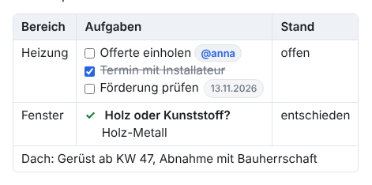
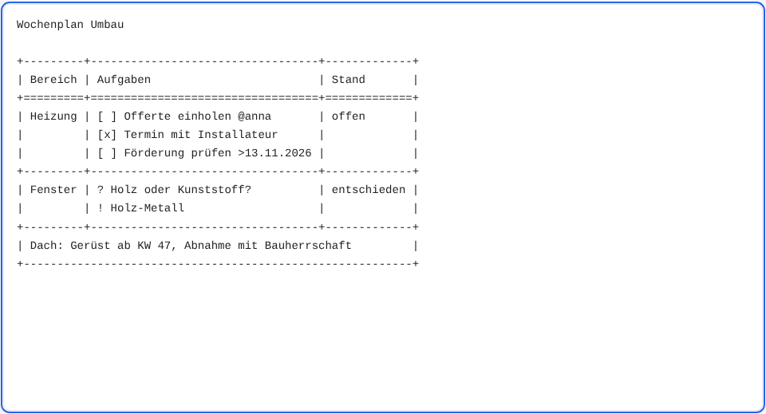
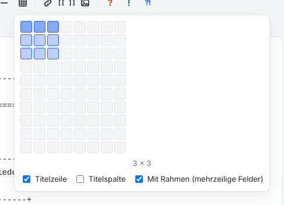
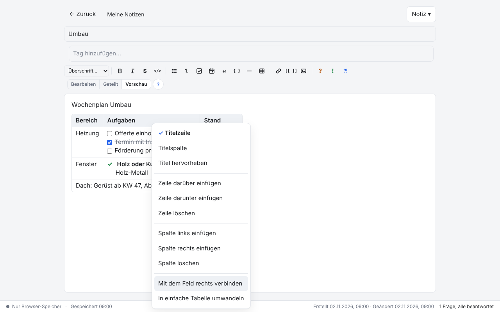

# NoNotes v3.3.0 – Tabellen mit Rahmen

Tabellen gibt es jetzt auch mit Rahmen: Jede Zeile der Tabelle steht zwischen zwei Linien. Ein Feld darf darum mehrere Zeilen Text
haben und sich über mehrere Spalten ziehen. Die bisherigen Tabellen bleiben, wie sie sind; ein Rechtsklick wandelt sie um, wenn man will.

## Was ist neu

### Tabellen mit Rahmen

Die Schreibweise ist die der «Grid Tables» von Pandoc: Linien aus `+` und `-` zwischen den Zeilen, `=` unter der Titelzeile. Was
zwischen zwei Linien steht, ist eine Zeile der Tabelle, so viele Textzeilen sie auch hat. Fehlt ein `|` zwischen zwei Spalten, zieht
sich das Feld über beide.

```
+---------+----------------------------------+-------------+
| Bereich | Aufgaben                         | Stand       |
+=========+==================================+=============+
| Heizung | [ ] Offerte einholen @anna       | offen       |
|         | [x] Termin mit Installateur      |             |
|         | [ ] Förderung prüfen >13.11.2026 |             |
+---------+----------------------------------+-------------+
| Dach: Gerüst ab KW 47, Abnahme mit Bauherrschaft         |
+----------------------------------------------------------+
```

In der Vorschau wird daraus eine gewöhnliche Tabelle. Jede Textzeile in einem Feld ist ein eigener Teil: eine Aufgabe hat ihr
Kästchen, eine Frage `?` bekommt ihre Antwort `!` auf der nächsten Zeile im selben Feld, und alles erscheint wie gewohnt in den
Listen für Aufgaben, Fragen und Entscheide. Eine Antwort aus der Liste schreibt NoNotes als neue Zeile ins Feld.



### Schreiben, ohne Striche zu zählen

Beim Tippen rückt NoNotes die Striche selbst zurecht, so dass alle `|` und `+` untereinander bleiben (rückgängig machen geht mit
<kbd>Strg+Z</kbd> wie immer). Solange eine Notiz eine Tabelle mit Rahmen enthält, schreibt der Editor in Festbreitenschrift, damit man
das auch sieht.

- <kbd>Tab</kbd> und <kbd>Umschalt+Tab</kbd> springen von Feld zu Feld.
- <kbd>Enter</kbd> beginnt eine neue Zeile im Feld.
- <kbd>Strg+Enter</kbd> fügt eine Zeile der Tabelle an; in einer leeren letzten Zeile endet die Tabelle.
- Rücktaste am Anfang und Entf am Ende einer Zeile im Feld verbinden die Zeilen, ohne den Rahmen zu zerstören.



### Einfügen, verbinden, teilen, umwandeln

Der Knopf *Tabelle einfügen* bietet neu **Mit Rahmen (mehrzeilige Felder)** an. Das ist vorgegeben; wer lieber einfache Tabellen
einfügt, nimmt den Haken weg, der Browser merkt es sich.



Der Rechtsklick auf eine Tabelle in der Vorschau kann zusätzlich:

- **Mit dem Feld rechts verbinden:** Das Feld zieht sich über eine Spalte mehr, der Text beider Felder steht untereinander. Bei einer
  einfachen Tabelle wird sie dafür zuerst eine mit Rahmen.
- **Feld teilen:** Ein verbundenes Feld wird wieder zu einzelnen Feldern; der Text bleibt im ersten.
- **In einfache Tabelle umwandeln** und **In Tabelle mit Rahmen umwandeln:** Die Zeilen eines Felds werden zu `<br>` und zurück.
  Verbundene Felder gibt es in einfachen Tabellen nicht; sie werden beim Umwandeln geteilt, der Text bleibt im ersten Feld.

Titelzeile, Titelspalte, Hervorheben und das Einfügen und Löschen von Zeilen und Spalten gehen wie bei einfachen Tabellen.



### Nachsichtig beim Lesen

<!-- ohne Bild: das Ergebnis sieht aus wie die Vorschau oben; der Unterschied liegt nur im Text, den das Beispiel unten zeigt -->

Von Hand geschriebene Tabellen müssen nicht genau stimmen. NoNotes liest sie auch, wenn die `|` nicht untereinander stehen, wenn
in den Linien Leerzeichen sind (`+ -------- +`) oder wenn unter der Titelzeile `| -------- | -------- |` statt `+=====+` steht:

```
+ -------- + -------- + -------- +
| Spalte 1 | Spalte 2 | Spalte 3 |
| -------- | -------- | -------- |
| Zeile 1 (3 Spalten breit)      |
+ ------------------------------ +
| Zeile 2,      |      |      |
| über 2 Zeilen |      |      |
+ ------------------------------ +
```

Beim nächsten Ausrichten (etwa mit <kbd>Tab</kbd>) bekommt die Tabelle die übliche Form.

Andere Markdown-Programme (GitHub, Obsidian) zeigen eine Tabelle mit Rahmen als Text; Pandoc liest sie als Tabelle. Wer eine Notiz
mit anderen Programmen teilt, wandelt die Tabelle vorher per Rechtsklick in eine einfache um.

## Update von v3.2.0

Die Notizen bleiben erhalten. Die Datenbank bleibt unverändert (Schema 18). Bestehende Tabellen bleiben einfache Tabellen; es wird
nichts umgeschrieben.

1. **Sichern:** *Datenbank → Kopie herunterladen (.sqlite)*, für jeden Bereich. Wer mit einer Datenbankdatei arbeitet, kopiert
   zusätzlich diese Datei.
2. **Herunterladen:** unten `NoNotes-v3.3.0.zip` oder `NoNotes-with-Plugins-v3.3.0.zip` und in einen neuen Ordner entpacken.
3. **Eigene Dateien übernehmen:** aus dem alten Ordner `plugins/plugins.js` (nur wenn dort Erweiterungen fest eingetragen sind),
   eigene Erweiterungen in `plugins/` und eigene Vorlagen in `templates/` in den neuen Ordner kopieren.
4. **Öffnen:** `index.html` im neuen Ordner im selben Browser wie bisher. Oben neben dem Namen steht jetzt v3.3.0. Mit
   Datenbankdatei einmal *Mit Datei verbinden*.
5. **Prüfen:** Notizen, Erweiterungen (*Datenbank → Erweiterungen…*) und Hauptfarbe sind wie vorher. Fehlen die Notizen (anderer
   Browser oder anderes Profil): *Datenbank → Aus Datei importieren…* mit der Sicherung aus Schritt 1.
6. Den alten Ordner löschen, wenn alles da ist.

**Zurück zur vorigen Version:** v3.2.x öffnet dieselbe Datenbank. Tabellen mit Rahmen zeigt sie aber nur als Text, und Aufgaben und
Fragen darin fehlen dort in den Listen, sobald die Notiz gespeichert wird. Wer zurück will, wandelt Tabellen mit Rahmen vorher per
Rechtsklick in einfache um.

**Erweiterungen:** Keine Änderung (`api: 1`). Wer Tabellen formatiert (`tableFormat`), bekommt bei Tabellen mit Rahmen zusätzlich
`grid: true` und `spans` (je Spalte die Breite des Felds, das dort beginnt); im Rechtsklick nennt das Ziel `grid` und `span`
([PLUGINS.md](../../PLUGINS.md)). Bestehende Erweiterungen laufen unverändert; ein von links überdecktes Feld hat leeren Text.

**Eigene Backends und Agenten:** Keine neue Methode. `answerQuestion` schreibt die Antwort in einer Tabelle mit Rahmen als neue Zeile
ins Feld, `toggleTaskTree` setzt das Kästchen der richtigen Zeile ([BACKEND.md](../../BACKEND.md)). Die Anleitung für Agenten
(`NoNotesAgent.INSTRUCTIONS`) erklärt Tabellen mit Rahmen, damit `answer_question` und `complete_task` sie wie einfache behandeln.

## Für Entwickler

- `NoNotesTables` (`packages/core/tables.js`) kennt zwei Arten (`kind: 'pipe'` und `'grid'`). Neu sind unter anderem `cellsOf`
  (die Felder einer Tabelle mit ihren Textzeilen), `hasGrid`, `typed` (Ausrichten nach einer Eingabe), `joinLine`, `snap`,
  `mergeRight`, `splitCell` und `convert`. Alles sind reine Funktionen auf dem Text; Tests in `test/core.cjs` («Tabellen mit Rahmen»)
  und `test/extend.cjs`.
- Neue Sprachtexte (14) in allen neun Sprachpaketen.
