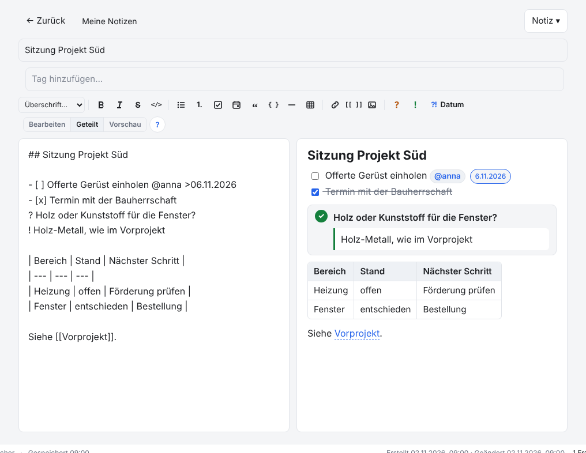
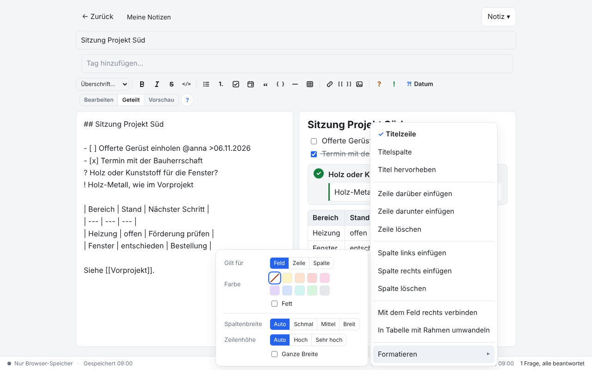

# NoNotes v4.0.0 – Editor als eigenes Paket

Der Editor und die Markdown-Engine von NoNotes sind jetzt ein eigenes Paket, [NoNotes-editor](https://github.com/CDRO/NoNotes-editor)
(MIT). Für die Arbeit mit NoNotes ändert sich nichts: Notizen, Bedienung, Tasten und Erweiterungen bleiben, wie sie sind. Die neue
Hauptversion gilt für alle, die NoNotes einbinden oder erweitern: Dateien sind umgezogen, und `NoNotesI18n.extend()` verhält sich anders.

## Was ist neu

### Der Editor kommt aus NoNotes-editor

Toolleiste, die drei Darstellungen (*Bearbeiten*, *Geteilt*, *Vorschau*), die Tasten beim Schreiben, die Datumsauswahl hinter `>`,
die Vorschläge für `@kürzel` und `[[Verweise]]`, Tabellen (auch mit Rahmen), Bilder, ausfüllbare Platzhalter und die Vorschau sind
ein Baustein im Paket NoNotes-editor. Dasselbe Paket benutzen SteeringBoard und NoNotes-SaaS, so dass Korrekturen am Editor allen
zugutekommen. In NoNotes sieht und arbeitet der Editor genau wie in v3.3.0; die beiden Bilder unten sind mit demselben Drehbuch
in v3.3.0 und v4.0.0 entstanden und gleichen sich Pixel für Pixel. Auch die Knöpfe und Menüeinträge von Erweiterungen stehen an
derselben Stelle, hier *Datum* aus den Beispielen und *Formatieren* aus «Tabellen formatieren».





Was der App gehört, bleibt in der App: Speichern mit Zusammenführen, der Konfliktdialog, Bilder in der Datenbank, Verweise auf
Notizen, Vorlagen, Verlauf, Druck, Export und die Agenten.

### Sprachen: Ergänzungen gewinnen

<!-- ohne Bild: eine Schnittstelle für Ausprägungen; in der Oberfläche von NoNotes selbst ändert sich kein Text -->

`NoNotesI18n.extend(code, texte)` ergänzt ein Sprachpaket um Texte einer Ausprägung oder Erweiterung. Bis v3.3.0 blieb dabei jeder
Text stehen, den das Paket schon hatte, und die Ergänzung wurde still übergangen. **Ab v4.0.0 gewinnt die Ergänzung**, egal ob sie vor
oder nach dem Paket geladen wird; ein späteres `extend()` ersetzt ein früheres, ein leerer Text ersetzt nichts. So kann eine
Ausprägung ihre eigenen Wörter durchsetzen, etwa «Eintrag» statt «Notiz»:

```js
NoNotesI18n.extend('en', { 'Übernehmen': 'Apply', 'Notiz': 'Entry' });
```

Die neun Sprachpakete übersetzen weiterhin auch alle Texte des Editors. Einzelheiten: [LANGUAGES.md](../../LANGUAGES.md).

## Update von v3.3.0

Die Notizen bleiben erhalten. Die Datenbank bleibt unverändert (Schema 18).

1. **Sichern:** *Datenbank → Kopie herunterladen (.sqlite)*, für jeden Bereich. Wer mit einer Datenbankdatei arbeitet, kopiert
   zusätzlich diese Datei.
2. **Herunterladen:** unten `NoNotes-v4.0.0.zip` oder `NoNotes-with-Plugins-v4.0.0.zip` und in einen neuen Ordner entpacken.
3. **Eigene Dateien übernehmen:** aus dem alten Ordner `plugins/plugins.js` (nur wenn dort Erweiterungen fest eingetragen sind),
   eigene Erweiterungen in `plugins/` und eigene Vorlagen in `templates/` in den neuen Ordner kopieren.
4. **Öffnen:** `index.html` im neuen Ordner im selben Browser wie bisher. Oben neben dem Namen steht jetzt v4.0.0. Mit
   Datenbankdatei einmal *Mit Datei verbinden*.
5. **Prüfen:** Notizen, Erweiterungen (*Datenbank → Erweiterungen…*) und Hauptfarbe sind wie vorher. Fehlen die Notizen (anderer
   Browser oder anderes Profil): *Datenbank → Aus Datei importieren…* mit der Sicherung aus Schritt 1.
6. Den alten Ordner löschen, wenn alles da ist.

Gemerkt bleiben die Darstellung des Editors und die Wahl «Mit Rahmen» beim Einfügen einer Tabelle (sie zieht beim ersten Start in
den Schlüssel des Pakets um, `nonotes-editor.tableGrid`).

**Zurück zur vorigen Version:** geht ohne Weiteres; v3.3.0 öffnet dieselbe Datenbank, es wurde nichts umgeschrieben.

**Erweiterungen:** Keine Änderung, alle laufen weiter (`api: 1`): die mitgelieferten und alle aus CDRO/NoNotes-plugins. `ctx.editor`,
`ctx.ui.addToolbarButton`, `ctx.tables.format`, `ctx.tables.update` und `ctx.ui.addTableMenuItem` verhalten sich wie bisher; die
globalen Namen (`NoNotesMarkdown`, `NoNotesEditing`, `NoNotesTables` …) und die Dateien in `js/` heissen wie zuvor, die Darstellung
steht weiter als Klasse an `#editorPane` ([PLUGINS.md](../../PLUGINS.md)). Nur wer `NoNotesI18n.extend()` benutzt hat, um fehlende
Texte nachzutragen, sollte prüfen, ob er damit nicht auch Texte der Sprachpakete ersetzt.

**Eigene Backends und Agenten:** Keine Änderung an der Schnittstelle ([BACKEND.md](../../BACKEND.md)) und an den Werkzeugen der
Agenten. Das Programm für Agenten auf dem eigenen Rechner lädt zusätzlich `js/labels.js` (liegt im ZIP).

**Ausprägungen und Projekte, die NoNotes einbinden** (als Submodul oder Kopie des Quelltexts): Der Quelltext braucht jetzt das Paket.
`npm install` holt es als devDependency (`"nonotes-editor": "github:CDRO/NoNotes-editor#v1.0.0"`); liegt NoNotes als Submodul in einem
anderen Projekt, genügt `nonotes-editor` in dessen `node_modules`. Elf Dateien sind aus NoNotes ins Paket gezogen: `packages/core/`
`markdown.js`, `tasks.js`, `questions.js`, `tables.js`, `editing.js`, `mentions.js`, `embeds.js`, `dates.js`, `placeholders.js` und
`packages/ui/` `datepicker.js`, `scrollsync.js`; wer sie über diese Pfade lädt (etwa ein Server in einem vm-Kontext), nimmt sie aus dem
Paket (`require('nonotes-editor').engine`) und lädt `labels.js` vor der Engine.

## Für Entwickler

- **Paket NoNotes-editor:** `tools/build.cjs` liest dessen Dateiliste (`files.cjs`) und setzt Skripte und Stylesheet an zwei neuen
  Platzhaltern der Seitenvorlage ein (die HTML-Kommentare `NONOTES-EDITOR-SCRIPTS` und `NONOTES-EDITOR-STYLES`); kopiert wird wie bisher flach
  nach `js/` und `css/`, dazu die Lizenz nach `js/nonotes-editor-LICENSE.txt` (siehe NOTICE). `tools/editor-package.cjs` findet das Paket
  für Build, Sprachwerkzeug und Tests. Aufbau: [ARCHITECTURE.md](../../ARCHITECTURE.md).
- **Editor in app.js:** `NoNotesEditor.create(#editorPane, { ids, onInput, attachments, refs, render, placeholders, … })` ersetzt rund
  1400 Zeilen eigenen Editor-Code. Die festen Kennungen (`#body`, `#preview`, `#mdToolbar`, `#modeSwitch`, `#attachBtn`, `#tablePicker` …)
  bleiben; die Regeln des Editors stehen in `editor.css` des Pakets, `app.css` behält den Rest.
- **Sprachen:** `tools/i18n.cjs` liest die Quelltexte des Pakets mit; die drei Titel «Bearbeiten (Ctrl+E)», «Geteilt (Ctrl+E)» und
  «Vorschau (Ctrl+E)» setzt der Editor aus «Bearbeiten» usw. zusammen und sind darum aus den Sprachpaketen verschwunden (gleicher Text).
  `NoNotesI18n.extend()`: die Ergänzung gewinnt (Test im Abschnitt «Sprachen» von `test/extend.cjs`).
- **Tests:** `NONOTES_CHROMIUM=/pfad/zu/chrome` nimmt ein vorhandenes Chromium oder `chrome-headless-shell` statt des Programms von
  Playwright (Tests, Sprachwerkzeug, Screenshots). Zwei Tests hingen von äusseren Umständen ab und sind behoben: «Ausfüllbare
  Platzhalter» in `test/core.cjs` läuft mit fester Uhr (am 31.10.2026 schrieb die Vorschau «heute · 31.10.2026»), «Pfade» in
  `test/app.cjs` wartet, bis der neue Tab geladen ist, bevor es dessen Adresse liest.
