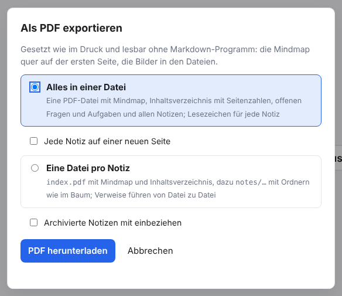
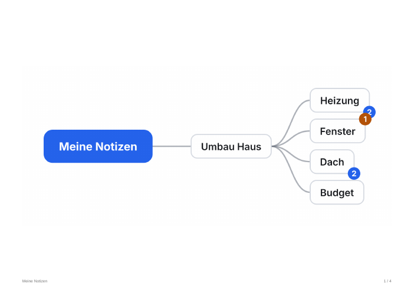
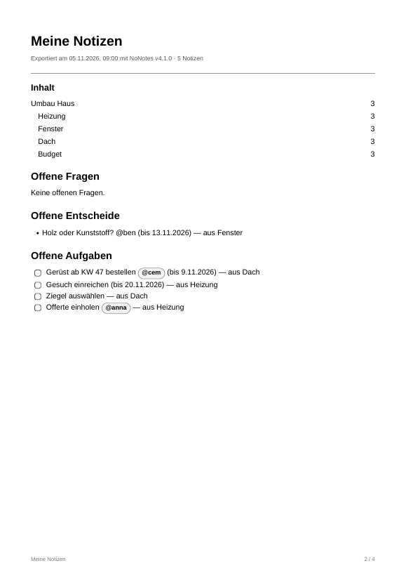
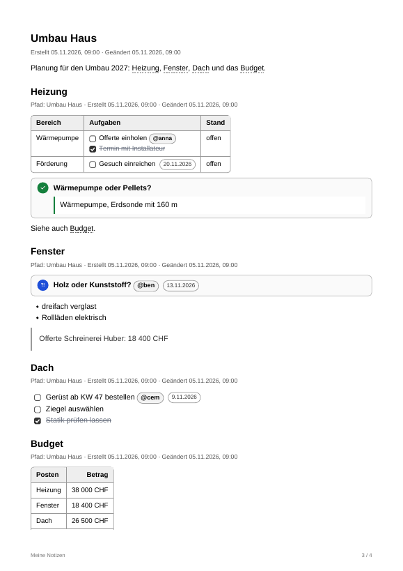

# NoNotes v4.1.0 – Export als PDF

Notizen lassen sich jetzt als PDF weitergeben, an alle, die kein Markdown-Programm haben: alles in einer Datei mit Inhaltsverzeichnis
und Lesezeichen oder eine Datei pro Notiz in Ordnern wie im Baum. Die PDF-Dateien sehen aus wie der Druck und entstehen ohne
Druckdialog, ganz im Browser.

## Was ist neu

### Als PDF exportieren

*Datenbank → Als PDF exportieren…* öffnet den Dialog mit den zwei Formen, die es schon beim Markdown-Export gibt. Archivierte Notizen
sind wie dort nur mit dem Kästchen dabei.

### Alles in einer Datei

Vorgegeben ist eine einzige PDF-Datei. Seite 1 zeigt die Mindmap quer auf A4, scharf genug zum Hineinzoomen.

Danach folgen der Titel mit Datum und Version, die Abschnitte von Erweiterungen (etwa eine Legende) und das Inhaltsverzeichnis mit
Seitenzahlen. Dahinter stehen die offenen Fragen, Entscheide und Aufgaben, wie im Markdown-Export. Ein Klick auf einen Eintrag
springt zur Notiz.

Die Notizen folgen in der Reihenfolge des Baums; die Tiefe im Baum bestimmt die Grösse der Überschrift. Sie stehen genau so da wie im
Druck: Tabellen (auch mit Rahmen), Kästchen, Fragen mit Antworten, Entscheide, Personen, Termine und die Farben von Erweiterungen wie
«Tabellen formatieren». `[[Verweise]]` springen innerhalb der Datei, Adressen öffnen die Webseite. Die erste Notiz beginnt auf einer
neuen Seite, mit **Jede Notiz auf einer neuen Seite** auch jede weitere. In der Seitenleiste des PDF-Programms steht für jede Notiz
ein Lesezeichen, unter ihrer Elternnotiz.

### Eine Datei pro Notiz

<!-- ohne Bild: die Seiten sehen aus wie oben; neu ist nur, wie sie auf Dateien verteilt sind -->

Wie beim Markdown-Export entsteht `index.pdf` mit Mindmap, Inhaltsverzeichnis und offenen Punkten. Dazu kommt eine PDF-Datei pro
Notiz, in Ordnern wie im Baum: `notes/umbau-haus.pdf`, `notes/umbau-haus/heizung.pdf` und so weiter. Jede Notiz endet mit der Liste
ihrer Unternotizen. Verweise, Inhaltsverzeichnis und Unternotizen führen von Datei zu Datei; dafür müssen die Dateien zusammen
in ihren Ordnern bleiben. Acrobat und die meisten PDF-Programme folgen solchen Links, manche PDF-Ansichten im Browser
nicht. Gespeichert wird in einen Ordner (Edge, Chrome) oder als ZIP.

### Gesetzt wie im Druck

<!-- ohne Bild: die Regeln betreffen alle Seiten oben -->

- **Seitenumbruch:** Eine Seite bricht nie mitten durch eine Zeile, ein Bild, eine Tabellenzeile oder eine Frage mit Antwort, und eine
  Überschrift bleibt bei ihrem Text. Läuft eine Tabelle über mehrere Seiten, steht ihre Titelzeile auf jeder davon.
- **Fusszeile:** Unten auf jeder Seite stehen Titel und Seitenzahl («3 / 12»).
- **Schrift:** Geschrieben wird in Helvetica, der Standardschrift jedes PDF-Programms; Code steht in Courier. Text in allen neun
  Sprachen ist durchsuchbar.
- **Sonderzeichen:** Zeichen ausserhalb der westeuropäischen Schrift (→, ✓, Emojis, Kyrillisch) kommen als kleine Bilder hinein.
  Sie sind zu sehen, lassen sich aber nicht durchsuchen.
- **Bilder:** Bilder stecken in den Dateien; ein JPEG kommt unverändert hinein.
- **Hell:** Auch bei dunkler Einstellung entsteht ein helles Dokument.

## Update von v4.0.0

Die Notizen bleiben erhalten. Die Datenbank bleibt unverändert (Schema 18).

1. **Sichern:** *Datenbank → Kopie herunterladen (.sqlite)*, für jeden Bereich. Wer mit einer Datenbankdatei arbeitet, kopiert
   zusätzlich diese Datei.
2. **Herunterladen:** unten `NoNotes-v4.1.0.zip` oder `NoNotes-with-Plugins-v4.1.0.zip` und in einen neuen Ordner entpacken.
3. **Eigene Dateien übernehmen:** aus dem alten Ordner `plugins/plugins.js` (nur wenn dort Erweiterungen fest eingetragen sind),
   eigene Erweiterungen in `plugins/` und eigene Vorlagen in `templates/` in den neuen Ordner kopieren.
4. **Öffnen:** `index.html` im neuen Ordner im selben Browser wie bisher. Oben neben dem Namen steht jetzt v4.1.0. Mit
   Datenbankdatei einmal *Mit Datei verbinden*.
5. **Prüfen:** Notizen, Erweiterungen (*Datenbank → Erweiterungen…*) und Hauptfarbe sind wie vorher. Fehlen die Notizen (anderer
   Browser oder anderes Profil): *Datenbank → Aus Datei importieren…* mit der Sicherung aus Schritt 1.
6. Den alten Ordner löschen, wenn alles da ist.

**Zurück zur vorigen Version:** v4.0.0 öffnet dieselbe Datenbank ohne Weiteres; es fehlt nur der PDF-Export.

**Erweiterungen:** Keine Änderung (`api: 1`). Farben im Mindmap-Bild (`ctx.export.addMapStyle`) und Abschnitte unter der Mindmap
(`ctx.export.addMapSection`) gelten auch im PDF-Export (`target: 'export'` wie beim Markdown-Export), ebenso das Format von Tabellen
(`ctx.tables.format`). Regeln einer Erweiterung für den Druck (`@media print { #printArea … }`) gelten im PDF-Export auch, wenn
ihr Stylesheet als `<style>` in der Seite steht ([PLUGINS.md](../../PLUGINS.md)).

**Eigene Backends und Agenten:** Keine Änderung. Der PDF-Export braucht nur Methoden, die es schon gibt (`getTree`, `getNote`,
`getAttachment` und die Listen; [BACKEND.md](../../BACKEND.md)).

## Für Entwickler

- `NoNotesPdf` (`packages/core/pdf.js`) ist ein eigener PDF-Schreiber ohne fremden Code: Standardschriften, Flächen, Rahmen, Pfade,
  Bilder (mit Transparenz, JPEG unverändert), Links (Adresse, Seite, andere Datei), Lesezeichen und Deflate. Er läuft auch in Node.
- `NoNotesPdfLayout` (`packages/ui/pdf-layout.js`) setzt HTML im Browser im unsichtbaren Bereich `#pdfArea` und liest Wörter,
  Flächen, Rahmen, Bilder, Kästchen, Listenzeichen und Links ab. Danach bricht er die Seiten um.
- `NoNotesPdfExport` (`packages/ui/pdf-export.js`) baut daraus die eine Datei oder die Dateien pro Notiz.
- Die Regeln des Drucks in `app.css` stehen nicht mehr in `@media print`, sondern gelten für `:is(#printArea, #pdfArea)`. Am
  Bildschirm ist der Druckbereich weiter unsichtbar, der Druck sieht aus wie bisher.
- Neue Funktionen in `NoNotesPrint`: `noteBodyHtml`, `attachmentUrls`, `metaHtml`, `titleResolver`. Neu in `NoNotesExport`:
  `placeFiles(nodes, ext)` und `openLines`.
- Neue Sprachtexte (12) in allen neun Sprachpaketen.
