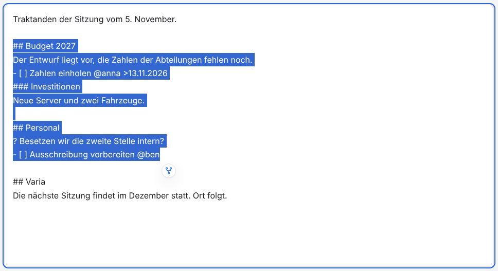
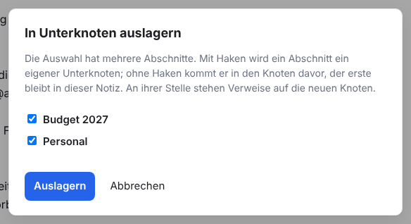
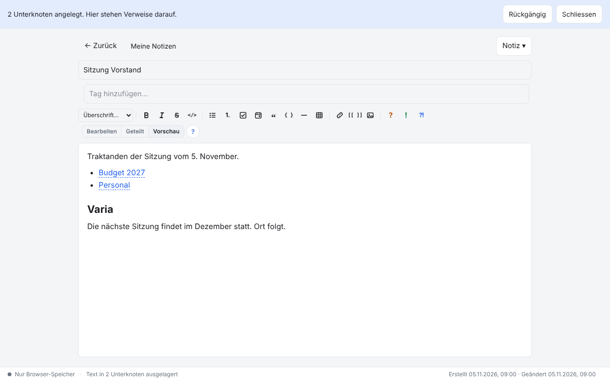
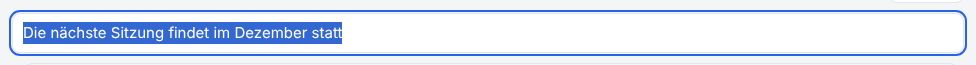
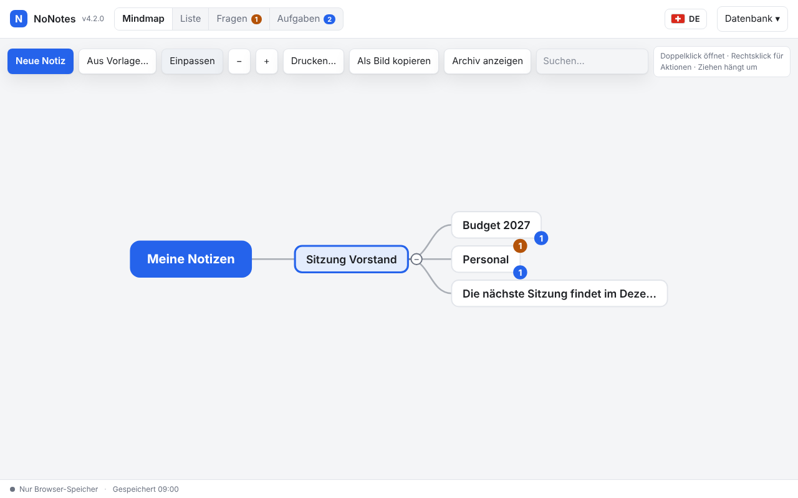

# NoNotes v4.2.0 – Text in Unterknoten auslagern

Wird eine Notiz zu lang, lässt sich ein Teil davon mit einem Klick in eine eigene Unternotiz verschieben. Wo der Text stand, steht
danach ein Verweis darauf. Überschriften werden zu Titeln, mehrere Abschnitte zu mehreren Unternotizen.

## Was ist neu

### Schaltfläche am Ende der Auswahl

Wähle im Editor Text aus, in *Bearbeiten*, *Geteilt* oder *Vorschau*. Am Ende der Auswahl erscheint eine runde Schaltfläche mit
einer Verzweigung. Ein Klick darauf (oder `Strg+Alt+U`) macht aus der Auswahl eine Unternotiz der offenen Notiz. An ihrer Stelle
steht ein Verweis wie `[[Budget 2027#42]]`. Die Nummer sorgt dafür, dass er auch nach dem Umbenennen oder Verschieben trifft; die
Vorschau zeigt nur den Titel.

### Überschriften werden Titel

Beginnt die Auswahl mit einer Überschrift, wird sie der Titel der Unternotiz. Tiefere Überschriften (etwa `###` unter `##`) bleiben
unverändert in ihrem Text. Stehen in der Auswahl mehrere Überschriften der obersten Ebene, gibt es für jede eine Unternotiz, und ein
Dialog fragt, welche. Ein Abschnitt ohne Haken kommt samt Überschrift in die Unternotiz davor; der erste bleibt ohne Haken in der
Notiz. Text vor der ersten Überschrift ist ein eigener Abschnitt.

Danach bleibt der Editor auf der Notiz. Die Verweise stehen als Liste da; beginnt die Auswahl mit einem Listenpunkt, behalten sie
dessen Zeichen und Einrückung. Oben steht «2 Unterknoten angelegt» mit **Rückgängig**: Der Text kommt zurück, die neuen
Unternotizen gehen in den Papierkorb. Die Leiste bleibt, bis du die Notiz wechselst. Aufgaben, Fragen und Entscheide zählen danach
in der Unternotiz, Bilder gehen mit.

### Ohne Überschrift: der erste Satz

Hat die Auswahl keine Überschrift, wird ihr erster Satz der Titel, höchstens 80 Zeichen lang. Ein längerer Satz wird am Wortende
gekürzt und endet mit «…». Markdown, Listenzeichen, Kästchen und Termine fallen dabei weg, «z. B.» oder «6. November» beenden den
Satz nicht. Öffnest du eine solche Unternotiz zum ersten Mal, steht der Fokus im Titel und er ist markiert: gleich tippen ersetzt
ihn. Benennst du sie in derselben Sitzung um, folgt der Verweis in der Notiz.

In der Mindmap hängen die neuen Unternotizen unter der Notiz, mit ihren offenen Fragen und Aufgaben.

### Genau oder in ganzen Blöcken

<!-- ohne Bild: die Markierung in der Vorschau sieht aus wie eine gewöhnliche Auswahl mit hellem Hintergrund -->

- **Mitten in einer Zeile** wird genau die Auswahl ausgelagert: aus «Wir wollen sparen» mit ausgewähltem «wollen» wird «Wir
  [[wollen#43]] sparen».
- **Ab dem Anfang einer Zeile** zählen ganze Zeilen; Leerzeilen am Rand bleiben stehen. Eine ausgelagerte Unterliste rückt in der
  Unternotiz nach links.
- **In der Vorschau** zählen ganze Blöcke: Absätze, Listenpunkte, Überschriften, Tabellen, Code und Einträge. Sie sind hell
  markiert, solange die Schaltfläche steht.
- Archivierte Notizen, der Papierkorb und der Lesemodus zeigen keine Schaltfläche.

### Für Agenten: extract_to_child

<!-- ohne Bild: ein Werkzeug für Agenten, ohne Oberfläche -->

Agenten (Claude Code, Copilot und andere über MCP) haben das neue Werkzeug `extract_to_child`. Es lagert ganze Zeilen einer Notiz nach
denselben Regeln aus. Mit `dry_run` zeigt es zuerst die Abschnitte samt Titel und Zeilen, `sections` wählt danach, welche eine
Unternotiz werden. `base_updated_at` schützt vor gleichzeitigen Änderungen ([AGENTS.md](../../AGENTS.md)).

## Behoben

- Im Vollbild-Editor (aus der Mindmap, den Fragen oder Aufgaben) lagen die Hinweisleiste oben und die Fehlermeldung unter dem
  Editor verdeckt, etwa die Rückfrage, wenn jemand anders dieselbe Notiz geändert hat. Jetzt stehen sie oben und unten fest, und der
  Editor rückt um ihre Höhe zusammen; nichts ist verdeckt.

## Update von v4.1.0

Die Notizen bleiben erhalten. Die Datenbank bleibt unverändert (Schema 18).

1. **Sichern:** *Datenbank → Kopie herunterladen (.sqlite)*, für jeden Bereich. Wer mit einer Datenbankdatei arbeitet, kopiert
   zusätzlich diese Datei.
2. **Herunterladen:** unten `NoNotes-v4.2.0.zip` oder `NoNotes-with-Plugins-v4.2.0.zip` und in einen neuen Ordner entpacken.
3. **Eigene Dateien übernehmen:** aus dem alten Ordner `plugins/plugins.js` (nur wenn dort Erweiterungen fest eingetragen sind),
   eigene Erweiterungen in `plugins/` und eigene Vorlagen in `templates/` in den neuen Ordner kopieren.
4. **Öffnen:** `index.html` im neuen Ordner im selben Browser wie bisher. Oben neben dem Namen steht jetzt v4.2.0. Mit
   Datenbankdatei einmal *Mit Datei verbinden*.
5. **Prüfen:** Notizen, Erweiterungen (*Datenbank → Erweiterungen…*) und Hauptfarbe sind wie vorher. Fehlen die Notizen (anderer
   Browser oder anderes Profil): *Datenbank → Aus Datei importieren…* mit der Sicherung aus Schritt 1.
6. Den alten Ordner löschen, wenn alles da ist.

**Zurück zur vorigen Version:** v4.1.0 öffnet dieselbe Datenbank ohne Weiteres. Ausgelagerte Unternotizen und ihre Verweise sind
gewöhnliche Notizen und `[[Verweise]]`; es fehlt nur die Schaltfläche.

**Erweiterungen:** Keine Änderung (`api: 1`). Das Auslagern schreibt den Text über den Editor, Erweiterungen sehen es wie eine
Eingabe (`note:saved`).

**Eigene Backends und Agenten:** Keine Änderung an der Schnittstelle. Das Auslagern braucht nur Methoden, die es schon gibt
(`createNote`, `updateNote`, `listAttachments`, `getAttachment`, `addAttachment`, `deleteAttachment`, `deleteNote`;
[BACKEND.md](../../BACKEND.md)). Wer den Werkzeugkatalog selbst lädt (wie der Server eines Dienstes), lädt
`packages/core/extract.js` vor `catalog.js`, sonst fehlt `extract_to_child`; das Programm `agent/nonotes-mcp.cjs` tut das schon.

## Für Entwickler

- `NoNotesExtract` (`packages/core/extract.js`) zerlegt eine Auswahl ohne DOM: `plan(body, start, end)` liefert die Abschnitte,
  `build(plan, chosen)` die Knoten nach der Wahl, `replacement` und `splice` den neuen Text. Über das Backend arbeiten
  `createNodes` (Unternotizen mit Bildern), `dropUnused` und `undo`. Die Datei läuft auch in Node.
- `NoNotesExtractUI` (`packages/ui/extract-ui.js`) zeigt die Schaltfläche (im Textfeld über einen Spiegel mit denselben
  Schriftmassen, in der Vorschau über `data-line` der Blöcke), den Dialog, die Leiste mit «Rückgängig» und den markierten Titel.
- Neue Sprachtexte (17) in allen neun Sprachpaketen.
