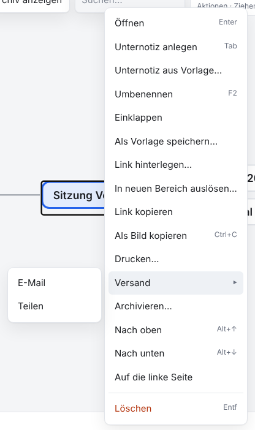
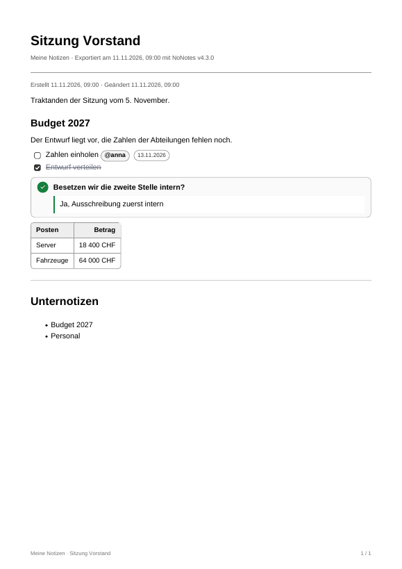
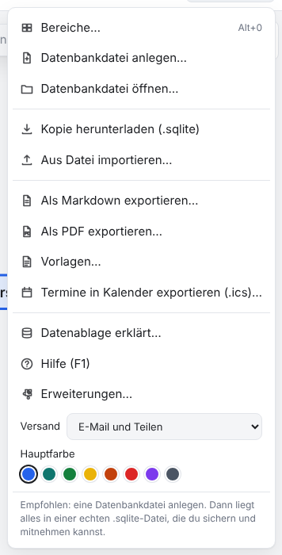

# NoNotes v4.3.0 – Notiz per E-Mail oder Teilen verschicken

Eine Notiz geht jetzt mit zwei Klicks als PDF ins Mail: Rechtsklick → Versand → E-Mail öffnet ein neues Mail mit dem Titel als
Betreff und der Notiz als Anhang, Teilen gibt das PDF an das Teilen-Fenster des Systems. Welche Wege im Menü stehen, ist einstellbar.

## Was ist neu

### Rechtsklick → Versand

Im Kontextmenü eines Knotens steht unter *Drucken…* der neue Eintrag **Versand** mit **E-Mail** und **Teilen**. Er steht auch bei
archivierten Notizen. Beide verschicken die Notiz als PDF, gesetzt wie beim PDF-Export: Titel, Angaben, Text mit Bildern, Tabellen,
Aufgaben, Fragen und Entscheiden, darunter die Titel der Unternotizen. Verweise auf andere Notizen bleiben Text, Adressen bleiben
Links.

### E-Mail: ein fertiger Entwurf

**E-Mail** lädt einen Mail-Entwurf herunter, zum Beispiel `Sitzung Vorstand.eml`. Ein Klick auf den Download öffnet ihn im
Mail-Programm als neues Mail: Betreff ist der Titel der Notiz, im Text steht «Anbei die Notiz … als PDF», angehängt ist
`Sitzung Vorstand.pdf`. Empfänger trägst du dort ein und schickst das Mail ab. Das klappt im klassischen Outlook und in Thunderbird
(ab Version 91). Andere Programme öffnen die Datei nur zum Lesen; dort bringt «Weiterleiten» dasselbe Mail mit dem Anhang.

### Teilen: das Teilen-Fenster des Systems

**Teilen** gibt das PDF an das Teilen-Fenster von Windows, macOS, iPhone oder Android. Dort wählst du das Ziel, etwa das
Mail-Programm, und es übernimmt das PDF und, wo es das kann, den Titel und den Text. Das geht in Edge und Chrome unter Windows und
macOS, in Safari und auf Handys. Firefox am Desktop und Linux haben kein Teilen-Fenster; dort steht nur E-Mail im Menü. Öffnet der
Browser das Fenster nicht mehr, weil das PDF lange brauchte, steht oben «Das PDF … ist bereit» mit **Teilen**.

<!-- ohne Bild: das Teilen-Fenster zeichnet das Betriebssystem, nicht NoNotes -->

### Einstellen, was im Menü steht

Unter *Datenbank → Versand* wählst du **E-Mail und Teilen** (vorgegeben), **Nur E-Mail (Entwurf)** oder **Nur Teilen**. Die Wahl gilt
für diesen Browser, weil sie vom Mail-Programm des Geräts abhängt: im Büro mit Outlook nur E-Mail, auf dem Laptop ohne Outlook nur
Teilen. Kann der Browser keine Dateien teilen, ist die Auswahl gesperrt und es bleibt E-Mail.

## Update von v4.2.0

Die Notizen bleiben erhalten. Die Datenbank bleibt unverändert (Schema 18).

1. **Sichern:** *Datenbank → Kopie herunterladen (.sqlite)*, für jeden Bereich. Wer mit einer Datenbankdatei arbeitet, kopiert
   zusätzlich diese Datei.
2. **Herunterladen:** unten `NoNotes-v4.3.0.zip` oder `NoNotes-with-Plugins-v4.3.0.zip` und in einen neuen Ordner entpacken.
3. **Eigene Dateien übernehmen:** aus dem alten Ordner `plugins/plugins.js` (nur wenn dort Erweiterungen fest eingetragen sind),
   eigene Erweiterungen in `plugins/` und eigene Vorlagen in `templates/` in den neuen Ordner kopieren.
4. **Öffnen:** `index.html` im neuen Ordner im selben Browser wie bisher. Oben neben dem Namen steht jetzt v4.3.0. Mit
   Datenbankdatei einmal *Mit Datei verbinden*.
5. **Prüfen:** Notizen, Erweiterungen (*Datenbank → Erweiterungen…*) und Hauptfarbe sind wie vorher. Fehlen die Notizen (anderer
   Browser oder anderes Profil): *Datenbank → Aus Datei importieren…* mit der Sicherung aus Schritt 1.
6. Den alten Ordner löschen, wenn alles da ist.

**Zurück zur vorigen Version:** v4.2.0 öffnet dieselbe Datenbank ohne Weiteres; es fehlt nur der Versand.

**Erweiterungen:** Keine Änderung (`api: 1`). Einträge von Erweiterungen im Kontextmenü stehen wie bisher darunter.

**Eigene Backends und Agenten:** Keine Änderung. Der Versand braucht nur Methoden, die es schon gibt (`getTree`, `getNote`,
`getAttachment`; [BACKEND.md](../../BACKEND.md)).

## Für Entwickler

- `NoNotesMail` (`packages/core/mail.js`) baut eine Nachricht nach RFC 5322 mit MIME (`eml({ subject, text, attachments, draft })`):
  Betreff und Namen der Anhänge als RFC-2047-Wörter in UTF-8, wie Outlook sie schreibt, Inhalte in Base64, mit `draft` die
  Entwurfsmarke `X-Unsent: 1`. Dazu `fileName` und `asciiName` für Dateinamen. Läuft auch in Node.
- `NoNotesPdfExport.buildNote(backend, id, options)` liefert eine einzelne Notiz als PDF.
- `NoNotesSend` (`packages/ui/send.js`) zeigt das Untermenü, teilt über `navigator.share` mit Datei und merkt sich die Einstellung
  unter `nonotes.sendWays` im Browser.
- Neue Sprachtexte (20) in allen neun Sprachpaketen.
