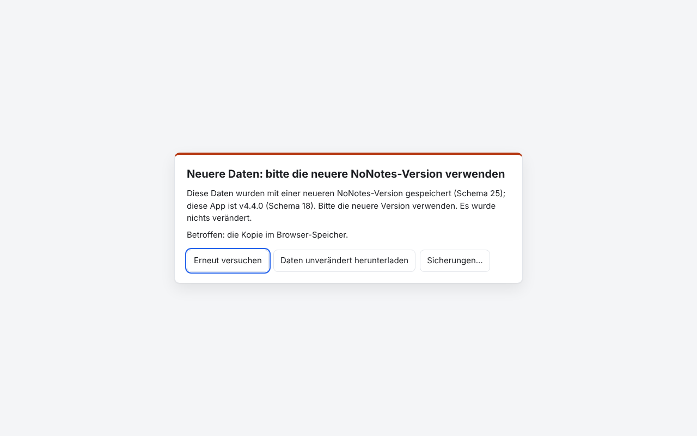
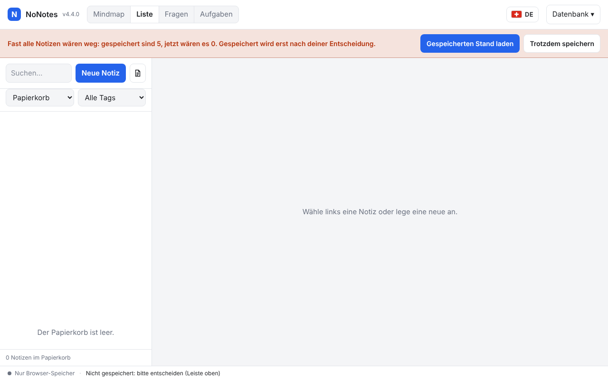
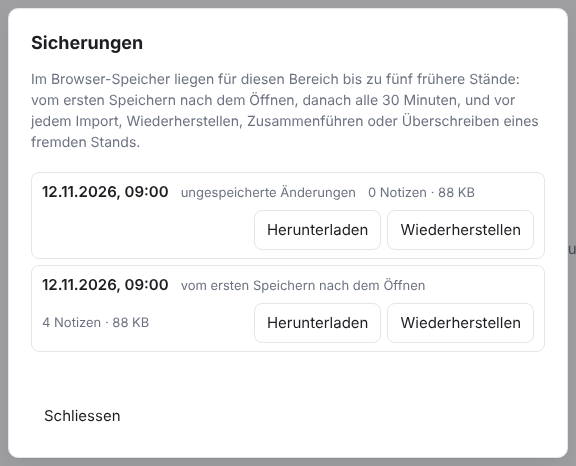

# NoNotes v4.4.0 – Sicher speichern

NoNotes überschreibt keine Daten mehr, die es nicht öffnen kann. Statt still leer zu beginnen, zeigt die App einen Stoppschirm. Vor
jedem Schreiben vergleicht sie die Datei. Ein Speichern, das fast alle Notizen löschen würde, hält sie an. Und sie hält je Bereich die
letzten 5 Stände als Sicherung bereit.

## Was ist neu

### Stoppschirm statt leerer App

Bisher konnte eine ältere NoNotes-Version eine Datei einer neueren nicht öffnen, begann dann leer und überschrieb beim nächsten
Speichern die echten Daten. Jetzt sperrt in diesem Fall ein Stoppschirm die App, und es wird nichts gespeichert. Er nennt den Grund:

- **Daten einer neueren NoNotes-Version**, mit beiden Schema-Nummern und der Version der App;
- **beschädigte Daten**, die die Prüfung von SQLite nicht bestehen;
- **keine NoNotes-Datenbank**;
- **nicht lesbar**, etwa weil das Netzlaufwerk gerade fehlt;
- eine gemerkte Datei **ohne Freigabe**, wenn es keine Browser-Kopie gibt.

Auswege sind «Erneut versuchen», ein anderer Bereich, «Daten unverändert herunterladen» und die Sicherungen. Leer beginnt die App nur,
wenn es wirklich keine Daten gibt. Speichert jemand die Datei während der Arbeit mit einer neueren Version, kommt derselbe Stoppschirm;
die eigenen ungespeicherten Änderungen liegen dann in den Sicherungen.

### Vor jedem Schreiben vergleichen

Bevor die App speichert, liest sie die Datei und vergleicht sie mit dem Stand, den sie geladen oder zuletzt gespeichert hat. Hat sich
die Datei geändert, führt sie zusammen oder fragt nach, wie bisher. Lässt sich die Datei nicht lesen, schreibt sie nichts, weder in
die Datei noch in die Browser-Kopie, und sagt es in der Statuszeile. Beim nächsten Speichern versucht sie es wieder.

<!-- ohne Bild: ein Lesefehler zeigt sich nur als Satz in der Statuszeile -->

### Halt, bevor fast alles weg ist

Wären nach dem Speichern von mindestens 3 Notizen weniger als ein Viertel übrig, hält die App das Speichern mit einer roten Leiste
an. **Gespeicherten Stand laden** holt die Notizen zurück, **Trotzdem speichern** speichert den kleineren Stand. Notizen im Papierkorb
und im Archiv zählen mit: Wer alle Notizen in den Papierkorb legt und ihn leert, bestätigt das so bewusst.

### Sicherungen: die letzten 5 Stände

Im Browser-Speicher liegen je Bereich die letzten 5 Stände, ohne Doppel. Die App legt sie an:

- vor dem ersten Überschreiben nach dem Öffnen;
- danach alle 30 Minuten;
- vor einem Import, dem Öffnen einer anderen Datei, dem Wiederherstellen und dem Zusammenführen;
- bevor sie einen Stand von aussen übernimmt oder überschreibt;
- mit den ungespeicherten Änderungen vor einem Stopp oder einem verworfenen Stand.

*Datenbank → Sicherungen…* listet sie mit Zeit, Anlass und Zahl der Notizen. Jede lässt sich herunterladen oder nach einer Rückfrage
wiederherstellen; der aktuelle Stand wird vorher selbst gesichert.

### Das Schema steht im Dateikopf

Jede gespeicherte Datenbank trägt ihre Schema-Nummer jetzt auch im Kopf der SQLite-Datei (`PRAGMA user_version`, Bytes 60–63), die
App die ihre als `window.NONOTES_SCHEMA` in `version.js`. Ein Skript kann so vor dem Einspielen einer älteren App-Version warnen, ohne
die Datenbank zu öffnen.

<!-- ohne Bild: vier Bytes im Dateikopf, in der App nicht zu sehen -->

## Update von v4.3.0

Die Notizen bleiben erhalten. Das Schema bleibt 18; beim ersten Speichern kommt die Nummer zusätzlich in den Dateikopf.

1. **Sichern:** *Datenbank → Kopie herunterladen (.sqlite)*, für jeden Bereich. Wer mit einer Datenbankdatei arbeitet, kopiert
   zusätzlich diese Datei.
2. **Herunterladen:** unten `NoNotes-v4.4.0.zip` oder `NoNotes-with-Plugins-v4.4.0.zip` und in einen neuen Ordner entpacken.
3. **Eigene Dateien übernehmen:** aus dem alten Ordner `plugins/plugins.js` (nur wenn dort Erweiterungen fest eingetragen sind),
   eigene Erweiterungen in `plugins/` und eigene Vorlagen in `templates/` in den neuen Ordner kopieren.
4. **Öffnen:** `index.html` im neuen Ordner im selben Browser wie bisher. Oben neben dem Namen steht jetzt v4.4.0. Mit
   Datenbankdatei einmal *Mit Datei verbinden*.
5. **Prüfen:** Notizen, Erweiterungen (*Datenbank → Erweiterungen…*) und Hauptfarbe sind wie vorher. Fehlen die Notizen (anderer
   Browser oder anderes Profil): *Datenbank → Aus Datei importieren…* mit der Sicherung aus Schritt 1.
6. Den alten Ordner löschen, wenn alles da ist.

**Zurück zur vorigen Version:** v4.3.0 öffnet dieselbe Datenbank ohne Weiteres; die Nummer im Dateikopf stört sie nicht. Es fehlen
dann der Stoppschirm, der Halt und die Sicherungen; die Sicherungen bleiben im Browser liegen, bis wieder v4.4.0 läuft.

**Erweiterungen:** Keine Änderung (`api: 1`).

**Eigene Backends und Agenten:** Keine Änderung der Schnittstelle ([BACKEND.md](../../BACKEND.md)). Das Programm für Agenten
(`agent/nonotes-mcp.cjs`) schreibt die Nummer ebenfalls in den Dateikopf und lehnt Dateien mit höherer Nummer ab.

## Für Entwickler

- `NoNotesDB.check(SQL, bytes)` prüft Bytes, ohne sie zu ändern: `null` oder `{ code: 'SCHEMA_TOO_NEW' | 'NOT_NONOTES_FILE' |
  'DAMAGED', params }`. Das Schema ist der grössere Wert von `meta.schema_version` und `PRAGMA user_version`, auch in `open`.
  `exportBytes` setzt `PRAGMA user_version`; `countRecords(db)` zählt alle Notizen, auch im Papierkorb und im Archiv.
- `NoNotesStorage.browserStore` hat `listBackups(area)`, `addBackup(area, bytes, { reason, notes, hash })` und
  `loadBackup(area, id)`: höchstens 5 je Bereich, gleiche Inhalte nur einmal, nacheinander angelegt. Die lokale Hülle bietet
  `shell.backups` (`list`, `download`, `restore`) und ruft `host.showStop`, `host.hideStop` und `host.openBackups`.
- `persistNow` prüft in dieser Reihenfolge: Halt bei Massenverlust, die Datei vor der Browser-Kopie, die Datei noch einmal vor dem
  Schreiben. Ein Lesefehler heisst: nichts schreiben. Einzelheiten in [ARCHITECTURE.md](../../ARCHITECTURE.md).
- Tests, die eine alte Datei nachbauen, setzen neben `meta.schema_version` auch `PRAGMA user_version = 0`.
- Neue Sprachtexte (44) in allen neun Sprachpaketen.

Dies ist der erste von drei Schritten. Als Nächstes: ruhige Wiederholungen auf unzuverlässigen Netzlaufwerken mit verständlichen
Meldungen und schnellerem Start (v4.5.0), danach die letzte Änderung beim Schliessen des Tabs (v4.6.0).
