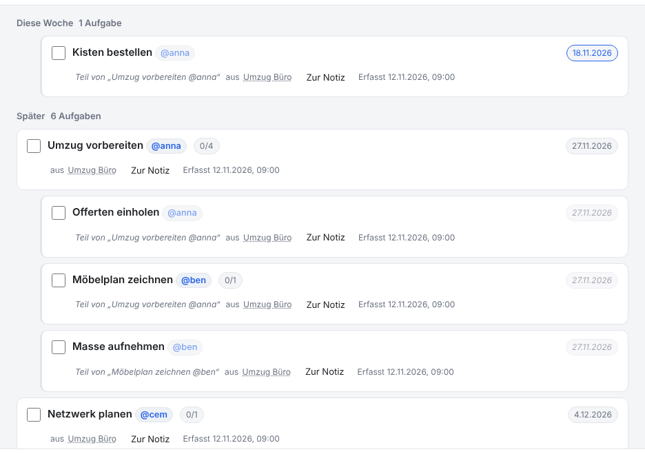

# NoNotes v4.5.0 – Unteraufgaben erben die Frist

Eine Unteraufgabe ohne eigenes Datum hat jetzt die Frist ihrer Hauptaufgabe. Sie steht in der Aufgabenliste am richtigen Ort, zählt
für «überfällig» und folgt, wenn sich die Frist der Hauptaufgabe ändert.

## Was ist neu

### Die Frist der Hauptaufgabe gilt auch darunter

```
- [ ] Umzug vorbereiten @anna >27.11.2026
  - [ ] Offerten einholen
  - [ ] Kisten bestellen >18.11.2026
  - [ ] Möbelplan zeichnen @ben
    - [ ] Masse aufnehmen
```

«Offerten einholen», «Möbelplan zeichnen» und «Masse aufnehmen» haben kein eigenes Datum. Sie gelten jetzt bis zum 27.11.2026, der
Frist von «Umzug vorbereiten». «Kisten bestellen» behält das eigene Datum: ein eigenes Datum geht immer vor. Bei tieferen Ebenen zählt
die nächste Hauptaufgabe darüber, die eine Frist hat. Steht unter «Kisten bestellen» eine weitere Unteraufgabe ohne Datum, gilt für
sie also der 18.11.2026.

Der Text bleibt, wie er ist: Das Datum wird nicht in die Zeilen geschrieben. Verschiebst du die Frist der Hauptaufgabe, folgen die
Unteraufgaben von selbst.

<!-- ohne Bild: das Beispiel oben zeigt den Text, das Bild der Aufgabenliste folgt im nächsten Abschnitt -->

### Wo die geerbte Frist zählt

- **Aufgabenliste:** Die geerbte Frist steht blass und schräg, mit dem Hinweis «Frist der Hauptaufgabe». Sortiert und gruppiert
  wird nach ihr, und eine Unteraufgabe mit abgelaufener geerbter Frist steht unter «Überfällig». Der Reiter zählt sie mit.
- **Druck und Export:** Die gedruckte Checkliste und die Liste «Offene Aufgaben» im Export nennen die Frist mit «Frist der
  Hauptaufgabe».
- **Agenten:** `list_tasks` liefert die Frist mit `due_inherited: true`. Die Anleitung sagt den Agenten, dass sie das Datum nicht in
  die Unteraufgabe kopieren sollen.
- **Dienst:** Die Morgenübersicht nimmt Unteraufgaben mit geerbter Frist unter «überfällig», «heute» und «die nächsten 7 Tage» auf.



### Im Kalender nur eigene Fristen

Der Kalenderexport (.ics) nimmt weiterhin nur Aufgaben mit eigenem Datum. Eine Hauptaufgabe mit acht Unteraufgaben bleibt so ein
Eintrag im Kalender und nicht neun am selben Tag.

<!-- ohne Bild: der Kalender sieht aus wie bisher -->

## Update von v4.4.0

Die Notizen bleiben erhalten. Die Datenbank bleibt unverändert (Schema 18); die geerbte Frist wird beim Lesen bestimmt.

1. **Sichern:** *Datenbank → Kopie herunterladen (.sqlite)*, für jeden Bereich. Wer mit einer Datenbankdatei arbeitet, kopiert
   zusätzlich diese Datei.
2. **Herunterladen:** unten `NoNotes-v4.5.0.zip` oder `NoNotes-with-Plugins-v4.5.0.zip` und in einen neuen Ordner entpacken.
3. **Eigene Dateien übernehmen:** aus dem alten Ordner `plugins/plugins.js` (nur wenn dort Erweiterungen fest eingetragen sind),
   eigene Erweiterungen in `plugins/` und eigene Vorlagen in `templates/` in den neuen Ordner kopieren.
4. **Öffnen:** `index.html` im neuen Ordner im selben Browser wie bisher. Oben neben dem Namen steht jetzt v4.5.0. Mit
   Datenbankdatei einmal *Mit Datei verbinden*.
5. **Prüfen:** Notizen, Erweiterungen (*Datenbank → Erweiterungen…*) und Hauptfarbe sind wie vorher. Fehlen die Notizen (anderer
   Browser oder anderes Profil): *Datenbank → Aus Datei importieren…* mit der Sicherung aus Schritt 1.
6. Den alten Ordner löschen, wenn alles da ist.

**Zurück zur vorigen Version:** v4.4.0 öffnet dieselbe Datenbank ohne Weiteres; Unteraufgaben ohne Datum haben dort wieder keine
Frist.

**Erweiterungen:** Keine Änderung (`api: 1`).

**Eigene Backends und Agenten:** `listTasks` liefert in `due` die geltende Frist und dazu `due_inherited`; `countTasks` zählt
«überfällig» danach. `getTask` nennt in `due` weiter nur die eigene ([BACKEND.md](../../BACKEND.md)). Wer ein eigenes Backend hat,
kann die Frist so bestimmen wie `packages/data/db.js` (eine rekursive Abfrage über `parent_id`).

## Für Entwickler

- `packages/data/db.js`: `EFFECTIVE_DUE` ist eine rekursive Abfrage über `tasks.parent_id`, die für jede Aufgabe die geltende Frist und
  `inherited` bestimmt; `listTasks` sortiert und `countTasks` zählt danach. Der Index (`tasks.due`) hält weiter nur die eigene Frist,
  darum ändert sich das Schema nicht.
- `NoNotesCalendar.build` überspringt Aufgaben mit `due_inherited`.
- Neue Sprachtexte (3) in allen neun Sprachpaketen.

Die in v4.4.0 angekündigten Schritte zum sicheren Speichern folgen als v4.6.0 (unzuverlässige Netzlaufwerke) und v4.7.0 (die letzte
Änderung beim Schliessen des Tabs).
