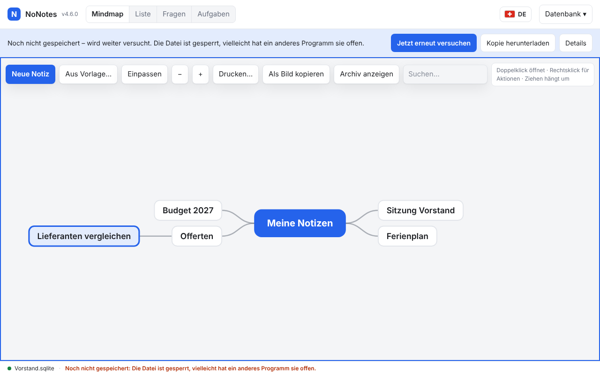
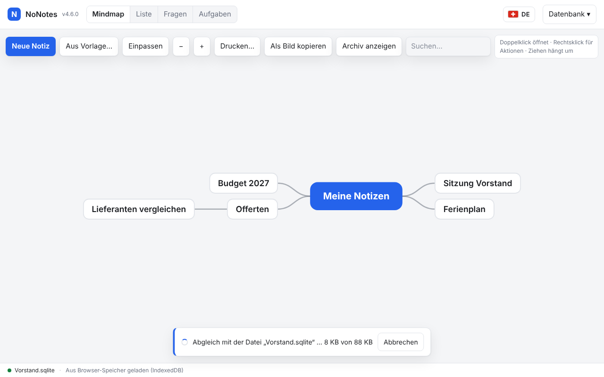

# NoNotes v4.6.0 – Speichern auf unzuverlässigen Laufwerken

Fehlt das Netzlaufwerk kurz, versucht NoNotes es still wieder. Erst wenn es länger dauert, erscheint eine ruhige Leiste. Die
Browser-Kopie weiss jetzt, ob sie der Datei voraus ist, und geht beim Verbinden nicht mehr verloren. Beim Öffnen ist die Kopie sofort
zu sehen, während die Datei im Hintergrund gelesen wird.

## Was ist neu

### Still wiederholen, dann eine ruhige Leiste

Scheitert das Lesen oder Schreiben der Datei, versucht NoNotes es nach 0,5, 1, 2, 4 und 8 Sekunden wieder. Die Statuszeile zeigt so
lange nur «Speichern…». Klappt es danach immer noch nicht, erscheint die Leiste «Noch nicht gespeichert – wird weiter versucht» mit:

- **Jetzt erneut versuchen**;
- **Kopie herunterladen**, damit der aktuelle Stand sicher irgendwo liegt;
- **Details**, mit der Meldung des Browsers.

Danach versucht NoNotes es alle 30 Sekunden. Neue Eingaben verbrauchen keinen Versuch; der nächste nimmt sie mit. Sobald das
Schreiben klappt, verschwindet die Leiste.

Die Meldung sagt in Worten, was los ist: «Die Datei ist gerade nicht erreichbar», «Die Datei ist gesperrt, vielleicht hat ein anderes
Programm sie offen», «Keine Berechtigung für die Datei», «Auf dem Laufwerk ist kein Platz mehr» und so weiter.

### Die Browser-Kopie geht nicht mehr verloren

Bisher konnte Folgendes passieren:

1. Die Datei war nicht erreichbar, die Änderungen landeten nur in der Browser-Kopie.
2. Der Tab wurde geschlossen.
3. Beim nächsten «Mit Datei verbinden» lud NoNotes die ältere Datei, und die neueren Änderungen waren weg.

Jetzt steht neben der Browser-Kopie, von welchem Stand der Datei sie ausging und ob sie ihm voraus ist. Beim Verbinden gilt:

- Nur die Kopie ist voraus: Sie kommt in die Datei.
- Nur die Datei hat sich geändert: Sie wird geladen, die bisherige Kopie liegt in den Sicherungen.
- Beide haben sich geändert: NoNotes führt Notiz für Notiz zusammen, mit dem alten Stand der Datei als Grundlage. Geht das nicht,
  fragt die Leiste wie bei Änderungen von aussen («Datei laden» oder «Meine Fassung behalten»), und die andere Fassung kommt in die
  Sicherungen.

<!-- ohne Bild: beim Verbinden ist meist nichts zu sehen, die Änderungen sind einfach da -->

### Nach dem Schreiben prüfen

Nach jedem Schreiben vergleicht NoNotes die Grösse der Datei. Stimmt sie nicht, gilt das Schreiben als gescheitert und wird
wiederholt. Ein halber eigener Stand in der Datei oder ein Schreiben, das trotz Fehlermeldung ankam, gilt dabei nicht als fremde
Änderung: Es kommt keine Rückfrage.

<!-- ohne Bild: die Prüfung läuft im Hintergrund -->

### Schneller öffnen, Fortschritt bei grossen Dateien

Ist die Datei beim Öffnen eines Bereichs schon freigegeben, zeigt NoNotes sofort die Browser-Kopie und gleicht danach ab. Liest sich
die Datei in einer Viertelsekunde, geschieht das, bevor etwas zu sehen ist. Sonst ist die Seite kurz gesperrt, und unten steht
«Abgleich mit der Datei „…“» mit dem Fortschritt.

- **Abbrechen** arbeitet mit der Kopie weiter. Die Datei bleibt unangetastet, und die Leiste bietet das Verbinden wieder an.
- Gibt es keine Kopie, erscheint die Leiste nach 2 Sekunden. Abbrechen führt dann zum Stoppschirm «Laden abgebrochen» mit «Erneut
  versuchen».

Grosse Dateien liest NoNotes in Stücken zu 1 MB. Ändert sich die Datei während des Lesens, liest NoNotes sie neu. Dauert das Lesen
beim Verbinden länger, zeigt die Statuszeile, wie weit es ist.

## Update von v4.5.0

Die Notizen bleiben erhalten. Die Datenbank bleibt unverändert (Schema 18). Der Abgleich-Eintrag entsteht beim ersten Speichern; bis
dahin gilt die Browser-Kopie wie bisher als Stand der Datei.

1. **Sichern:** *Datenbank → Kopie herunterladen (.sqlite)*, für jeden Bereich. Wer mit einer Datenbankdatei arbeitet, kopiert
   zusätzlich diese Datei.
2. **Herunterladen:** unten `NoNotes-v4.6.0.zip` oder `NoNotes-with-Plugins-v4.6.0.zip` und in einen neuen Ordner entpacken.
3. **Eigene Dateien übernehmen:** aus dem alten Ordner `plugins/plugins.js` (nur wenn dort Erweiterungen fest eingetragen sind),
   eigene Erweiterungen in `plugins/` und eigene Vorlagen in `templates/` in den neuen Ordner kopieren.
4. **Öffnen:** `index.html` im neuen Ordner im selben Browser wie bisher. Oben neben dem Namen steht jetzt v4.6.0. Mit
   Datenbankdatei einmal *Mit Datei verbinden*.
5. **Prüfen:** Notizen, Erweiterungen (*Datenbank → Erweiterungen…*) und Hauptfarbe sind wie vorher. Fehlen die Notizen (anderer
   Browser oder anderes Profil): *Datenbank → Aus Datei importieren…* mit der Sicherung aus Schritt 1.
6. Den alten Ordner löschen, wenn alles da ist.

**Zurück zur vorigen Version:** v4.5.0 öffnet dieselbe Datenbank ohne Weiteres und übergeht den Abgleich-Eintrag. Speichert sie die
Kopie neu, passt der Eintrag nicht mehr zu ihr, und v4.6.0 verhält sich danach wieder wie bei Daten von vor 4.6.0.

**Erweiterungen:** Keine Änderung (`api: 1`).

**Eigene Backends und Agenten:** Keine Änderung. Das betrifft nur die lokale Ausprägung (`packages/store-local/`).

## Für Entwickler

- `NoNotesStorage.fileAccess.read(handle, { onProgress, signal })` liest in Stücken (`window.NONOTES_READ_CHUNK`), bricht über das
  Signal ab und liest neu bei `FileChangedError` oder `NotReadableError`. `write` prüft danach die Grösse (`SizeMismatchError`).
- `browserStore.saveDb(bytes, area, sync)` schreibt den Abgleich-Eintrag `sync:<bereich>` in derselben Transaktion;
  `saveSync`, `loadSync` und `loadSyncBase` für den Eintrag und die Grundlage `syncbase:<bereich>`.
- Die lokale Hülle wiederholt über `saveFailed` mit `window.NONOTES_RETRY_MS` (sechs Wartezeiten, die letzte gilt danach) und
  gleicht in `reconcile` ab. Die Oberfläche bietet `host.showSync(text, onCancel)` und `host.hideSync()` für die Leiste.
- Neue Sprachtexte (29) in allen neun Sprachpaketen.

Als Nächstes kommt v4.7.0 mit der letzten Änderung beim Schliessen des Tabs.
