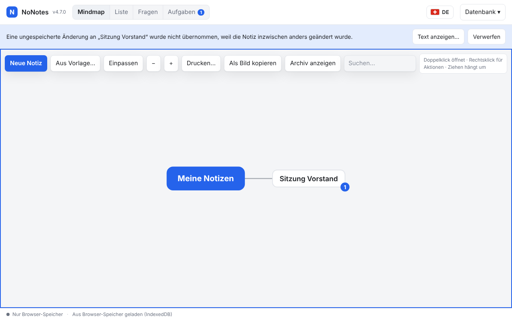
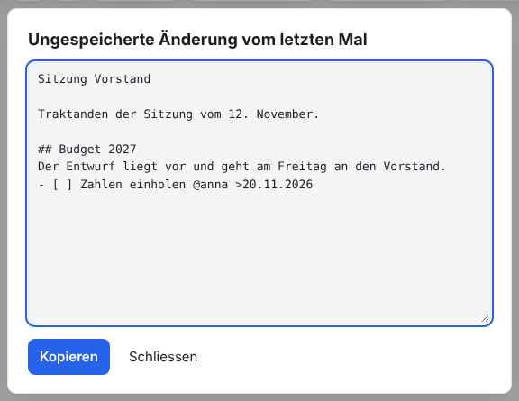

# NoNotes v4.7.0 – Die letzte Änderung beim Schliessen

Wer den Tab gleich nach dem Tippen schliesst, verliert die letzten Zeichen nicht mehr. NoNotes legt beim Schliessen synchron eine
Rettungskopie der ungespeicherten Texte ab und übernimmt sie beim nächsten Öffnen. Zwei Tabs ohne Datenbankdatei überschreiben
einander nicht mehr.

## Was ist neu

### Rettungskopie der ungespeicherten Texte

NoNotes speichert kurz nach jeder Eingabe. Schloss jemand den Tab genau in diesem Moment, konnte das Speichern abbrechen. Jetzt
legt NoNotes beim Schliessen, beim Neuladen und beim Verstecken des Tabs die Titel und Texte, die noch nicht gespeichert sind,
sofort im Speicher des Browsers ab:

- Das geschieht synchron, damit nichts mehr dazwischenkommt.
- Jeder Tab hat dafür einen eigenen Platz.
- Abgelegt werden nur die geänderten Texte, nie die ganze Datenbank.

Beim nächsten Öffnen des Bereichs übernimmt NoNotes sie als neue Fassung, im Verlauf nachvollziehbar. Ist alles gespeichert,
verschwindet die Rettungskopie wieder.

<!-- ohne Bild: beim nächsten Öffnen ist die Änderung einfach da -->

### Wenn die Notiz inzwischen anders geändert wurde

Wurde die Notiz inzwischen an anderer Stelle geändert, etwa in einem anderen Tab oder von einem Agenten, führt NoNotes zeilenweise
zusammen. Wurde dieselbe Stelle anders geändert, überschreibt NoNotes nichts. Eine ruhige Leiste nennt die Notiz:

- **Text anzeigen…** zeigt die gerettete Fassung zum Lesen und Kopieren.
- **Verwerfen** löscht die Rettungskopie.

Auf dem Stoppschirm und während des Abgleichs mit der Datei übernimmt NoNotes nichts; die Rettungskopie wartet.

### Die Browser-Kopie sofort beim Verlassen

Beim Verlassen der Seite schreibt NoNotes die Browser-Kopie, bevor es die Datei liest, und markiert sie als der Datei voraus. Hängt
gerade das Netzlaufwerk, ist der Stand trotzdem gesichert. Der nächste Start bringt ihn in die Datei oder führt zusammen, wie mit
v4.6.0 eingeführt.

<!-- ohne Bild: geschieht beim Schliessen -->

### Tabs ohne Datei

Ohne Datenbankdatei teilen sich alle Tabs die Browser-Kopie. Bisher meldete ein Tab dem anderen, dass er gespeichert hat. Kam die
Meldung nicht an, konnte der zweite Tab die Änderungen des ersten überschreiben. Jetzt sieht ein Tab vor dem Schreiben im
Abgleich-Eintrag nach, ob seither ein anderer geschrieben hat. Wenn ja, führt er dessen Stand zusammen, statt ihn zu überschreiben.

<!-- ohne Bild: geschieht im Hintergrund -->

## Update von v4.6.0

Die Notizen bleiben erhalten. Die Datenbank bleibt unverändert (Schema 18).

1. **Sichern:** *Datenbank → Kopie herunterladen (.sqlite)*, für jeden Bereich. Wer mit einer Datenbankdatei arbeitet, kopiert
   zusätzlich diese Datei.
2. **Herunterladen:** unten `NoNotes-v4.7.0.zip` oder `NoNotes-with-Plugins-v4.7.0.zip` und in einen neuen Ordner entpacken.
3. **Eigene Dateien übernehmen:** aus dem alten Ordner `plugins/plugins.js` (nur wenn dort Erweiterungen fest eingetragen sind),
   eigene Erweiterungen in `plugins/` und eigene Vorlagen in `templates/` in den neuen Ordner kopieren.
4. **Öffnen:** `index.html` im neuen Ordner im selben Browser wie bisher. Oben neben dem Namen steht jetzt v4.7.0. Mit
   Datenbankdatei einmal *Mit Datei verbinden*.
5. **Prüfen:** Notizen, Erweiterungen (*Datenbank → Erweiterungen…*) und Hauptfarbe sind wie vorher. Fehlen die Notizen (anderer
   Browser oder anderes Profil): *Datenbank → Aus Datei importieren…* mit der Sicherung aus Schritt 1.
6. Den alten Ordner löschen, wenn alles da ist.

**Zurück zur vorigen Version:** v4.6.0 öffnet dieselbe Datenbank ohne Weiteres. Rettungskopien bleiben im Browser liegen, bis wieder
v4.7.0 läuft.

**Erweiterungen:** Keine Änderung (`api: 1`).

**Eigene Backends und Agenten:** Keine Änderung. Das betrifft nur die lokale Ausprägung (`packages/store-local/`) und die Oberfläche
(`host.unsavedEditor`, `host.showText`).

## Für Entwickler

- Rettungskopie: `nonotes.rescue.<tabId>` im `localStorage`, `{ area, at, entries }`. Ein Eintrag ist entweder
  `{ note, field, base, value, label }` oder, für eine neue Notiz, `{ note, created, parent, title, body }`. `restoreRescued` übernimmt
  die Einträge nach dem Öffnen eines Bereichs, mit `NoNotesMerge.merge3` bei Änderungen dazwischen. Einzelheiten in
  [ARCHITECTURE.md](../../ARCHITECTURE.md).
- `quickMirror` schreibt beim Verlassen die Browser-Kopie mit `dirty: true`. `otherTabWrote` vergleicht vor dem Schreiben ohne Datei
  den `mirrorHash` des Abgleich-Eintrags.
- Neue Sprachtexte (7) in allen neun Sprachpaketen.

Damit sind die drei Schritte zum sicheren Speichern abgeschlossen (v4.4.0, v4.6.0, v4.7.0).
