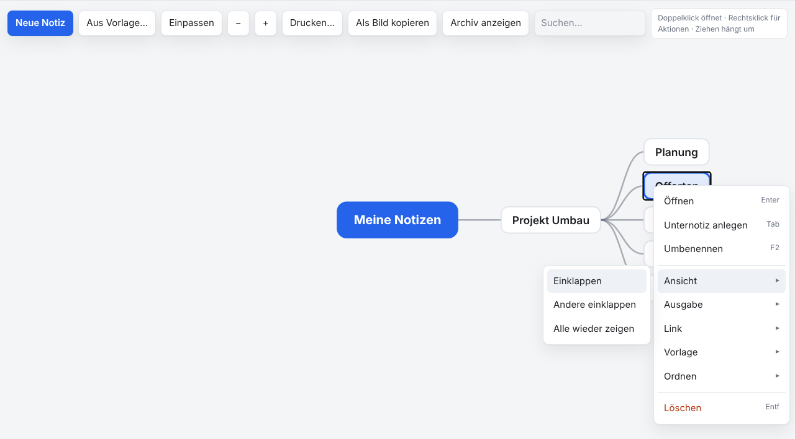
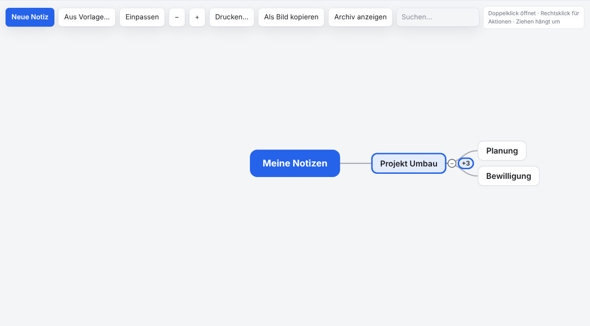
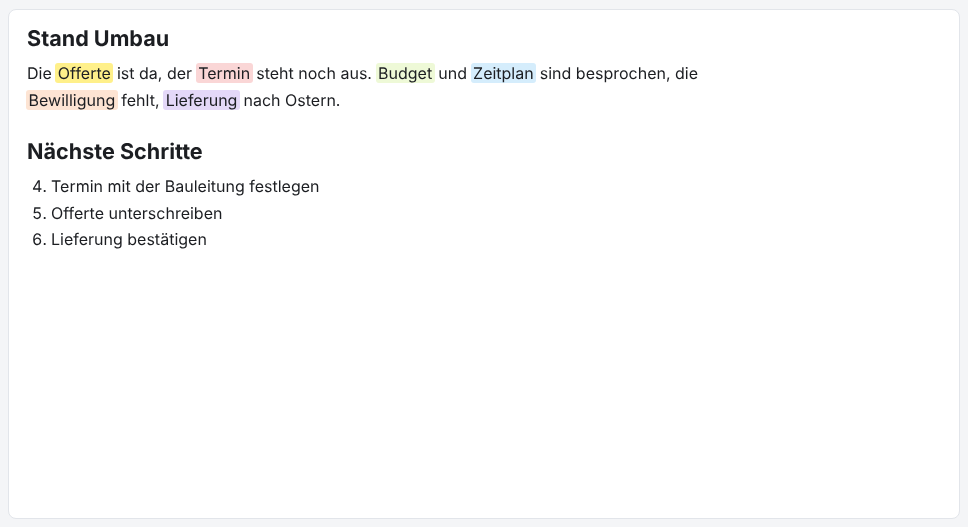
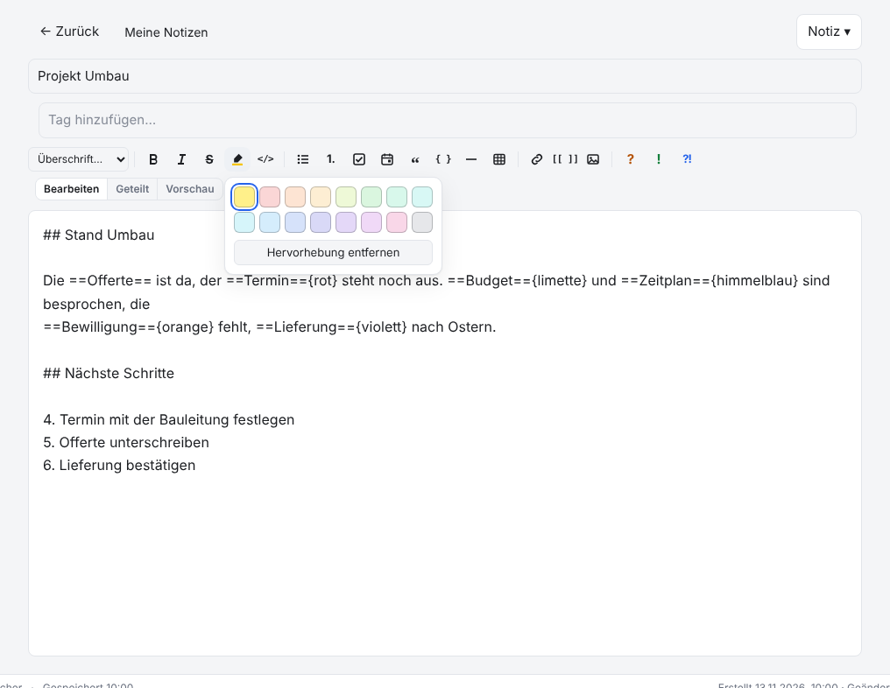

# NoNotes v4.8.0 – Rechtsklick nach Themen, Äste teilweise einklappen, Hervorheben

Das Rechtsklick-Menü eines Knotens ist nach Themen geordnet, in der Mindmap lassen sich einzelne Unternotizen eines Asts ausblenden, und
im Editor lässt sich Text mit 16 Farben hervorheben. Nummerierte Listen beginnen ausserdem mit ihrer ersten Zahl.

## Was ist neu

### Rechtsklick-Menü nach Themen

Das Menü eines Knotens war zu einer langen Liste gewachsen. Jetzt stehen oben **Öffnen**, **Unternotiz anlegen** und **Umbenennen**,
darunter fünf Gruppen als Untermenüs, am Ende **Löschen**:

- **Ansicht:** Unternotizen ein- und ausklappen, Einklappen, Andere einklappen, Alle wieder zeigen.
- **Ausgabe:** Als Bild kopieren, Drucken…, Versand per E-Mail oder Teilen.
- **Link:** Link kopieren, Link hinterlegen…, mit Link auch öffnen, ändern und entfernen.
- **Vorlage:** Unternotiz aus Vorlage…, Als Vorlage speichern… (nur, wenn Vorlagen zur Verfügung stehen).
- **Ordnen:** Nach oben, Nach unten, Auf die linke oder rechte Seite, In neuen Bereich auslösen…, Archivieren….

Ein Untermenü öffnet sich beim Daraufzeigen, mit `→` oder mit einem Klick; `Esc` oder `←` schliesst es wieder. Die Einträge der
Erweiterungen (etwa *Farbe*) stehen weiterhin darunter. Im Lesemodus fehlen die schreibenden Einträge, leere Untermenüs erscheinen nicht.

### Teile eines Asts einklappen

Bisher liess sich ein Ast nur ganz einklappen. Jetzt blendet *Ansicht → **Einklappen*** einzelne Unternotizen samt ihrem Teilbaum aus,
bei einer Mehrfachauswahl (`Ctrl`+Klick) alle markierten. Die Geschwister bleiben sichtbar. *Andere einklappen* macht das Gegenteil:
es blendet alle Geschwister aus, die nicht markiert sind.

- Der Elternknoten zeigt die Zahl der ausgeblendeten Unternotizen als **«+N»**. Ein Klick darauf zeigt sie wieder, ebenso *Ansicht →
  Alle wieder zeigen*, *Alles ausklappen* und das Öffnen einer ausgeblendeten Notiz aus der Liste, einem Link oder der Suche.
- Offene Fragen, Entscheide und Aufgaben ausgeblendeter Notizen zählen beim Elternknoten weiter mit, Suchtreffer darin färben ihn.
- Auch Hauptäste lassen sich ausblenden; das Zeichen steht dann an der Wurzel.
- Das Bild und die Kopie der Mindmap zeigen sie so, wie sie zu sehen ist.

### Hervorheben mit 16 Farben

Im Text lässt sich jetzt etwas unterlegen wie mit einem Leuchtstift: `==Text==` ist gelb, `==Text=={rot}` trägt eine von 16 Farben. Das
sind die Knotenfarben der Erweiterung «Farben über Tags»: Rot, Orange, Bernstein, Gelb, Limette, Grün, Smaragd, Türkis, Cyan,
Himmelblau, Blau, Indigo, Violett, Purpur, Pink und Grau, deutsch oder englisch geschrieben.

- In der Toolleiste öffnet der Knopf **Hervorheben** ein Farbfenster: Text markieren, Farbe wählen. Liegt die Markierung schon in einer
  Hervorhebung, ändert die Wahl deren Farbe; **Hervorhebung entfernen** nimmt sie weg.
- `Ctrl`+`Shift`+`H` setzt gelb (und schaltet gelb wieder aus).
- Ein unbekannter Farbname gibt gelb und bleibt als Text stehen. Fett, kursiv und Links wirken innerhalb der Hervorhebung, in Code nicht;
  `\==` bleibt Text.
- Vorschau, Druck und PDF zeigen die Füllung hell, auch bei dunkler Systemeinstellung. Der Markdown-Export lässt den Text, wie er
  geschrieben ist.

### Nummerierte Listen beginnen mit ihrer ersten Zahl

Eine nummerierte Liste zählt ab der Zahl, mit der sie beginnt: «4. Termin festlegen» nach einer Überschrift wird in Vorschau, Druck und
PDF zu 4, nicht mehr zu 1. Es gibt dafür keine neue Schreibweise (eine Form wie «4..» braucht es nicht), es ist gewöhnliches Markdown.

- Das gilt auch in Unterlisten. Eine eingerückte Fortsetzungszeile gehört zum Punkt davor.
- `Enter` führt die Liste mit der nächsten Zahl weiter, das Neunummerieren behält die Startnummer.

Das Bild der Vorschau oben zeigt unter «Nächste Schritte» eine Liste, die bei 4 beginnt.

<!-- ohne Bild: die Liste ist im Bild von «Hervorheben mit 16 Farben» zu sehen -->

## Update von v4.7.0

Die Notizen bleiben erhalten. Die Datenbank bleibt unverändert (Schema 18); ausgeblendete Notizen merkt sich NoNotes im zweiten Bit des
bisherigen Felds für das Einklappen.

1. **Sichern:** *Datenbank → Kopie herunterladen (.sqlite)*, für jeden Bereich. Wer mit einer Datenbankdatei arbeitet, kopiert
   zusätzlich diese Datei.
2. **Herunterladen:** unten `NoNotes-v4.8.0.zip` oder `NoNotes-with-Plugins-v4.8.0.zip` und in einen neuen Ordner entpacken.
3. **Eigene Dateien übernehmen:** aus dem alten Ordner `plugins/plugins.js` (nur wenn dort Erweiterungen fest eingetragen sind),
   eigene Erweiterungen in `plugins/` und eigene Vorlagen in `templates/` in den neuen Ordner kopieren.
4. **Öffnen:** `index.html` im neuen Ordner im selben Browser wie bisher. Oben neben dem Namen steht jetzt v4.8.0. Mit
   Datenbankdatei einmal *Mit Datei verbinden*.
5. **Prüfen:** Notizen, Erweiterungen (*Datenbank → Erweiterungen…*) und Hauptfarbe sind wie vorher. Fehlen die Notizen (anderer
   Browser oder anderes Profil): *Datenbank → Aus Datei importieren…* mit der Sicherung aus Schritt 1.
6. Den alten Ordner löschen, wenn alles da ist.

**Zurück zur vorigen Version:** v4.7.0 öffnet dieselbe Datenbank ohne Weiteres. Die Mindmap kennt dort das Ausblenden nicht:
ausgeblendete Notizen erscheinen wieder, und ihre eigenen Unternotizen gelten als eingeklappt. Ein `==Text==` zeigt die ältere Version
als Text mit den Gleichheitszeichen.

**Erweiterungen:** Keine Änderung (`api: 1`). Erweiterungen, die einen Eintrag im Menü eines Knotens anbieten (`ctx.ui.addContextMenuItem`),
stehen weiter unter den Gruppen.

**Eigene Backends und Agenten:** Das Backend hat zwei neue Aufrufe, `setHidden` und `showHiddenChildren`; `getTree` liefert
`collapsed` als Bitfeld (Bit 1 eingeklappt, Bit 2 ausgeblendet). Die Werkzeuge der Agenten sind unverändert.

## Für Entwickler

- Das Paket `nonotes-editor` steht auf v1.4.0 (vorher v1.0.0): Startnummer nummerierter Listen (`<ol start>`), Hervorheben
  (`<mark class="md-hl md-hl-<kennung>">`, `NoNotesMarkdown.HIGHLIGHTS`, `highlightId`, `findHighlights`; `NoNotesEditing.highlight`,
  `removeHighlight`, `highlightAt`) und die Optionen aus v1.1.0 bis v1.3.0, die NoNotes nicht braucht.
- `notes.collapsed` ist ein Bitfeld, siehe [ARCHITECTURE.md](../../ARCHITECTURE.md) und [BACKEND.md](../../BACKEND.md).
- Druck und PDF-Export: `app.css` legt die hellen Füllungen der Hervorhebungen für `#printArea` und `#pdfArea` fest, das Blatt
  `mark.md-hl` behält seine Farbe (`print-color-adjust: exact`); Suchtreffer (`<mark>` ohne Klasse) bleiben fett.
- Neue Sprachtexte (Menügruppen, Einklappen, 14 Texte des Editors, Hilfe) in allen neun Sprachpaketen.
